# Phase 1: Foundations (Lessons 01-08)

Read `00-conventions.md` first. All numbers are approximate unless stated.

---

## 01. How the web actually works

**Phase:** Foundations | **Level:** Beginner | **Read time:** 12 min | **Prerequisites:** none

### Learning objectives
- Trace what happens between typing a URL and seeing a page.
- Name the job of DNS, TCP, TLS, HTTP and the web server.
- Explain why a first visit is slower than a repeat visit.
- Point at where caches and CDNs can shortcut the path.

### Plain-language explanation
The web is millions of computers that follow shared conventions for asking and answering.
Your browser knows a name (`example.com`) but needs a numeric address, so it asks DNS,
which works like a phone book. It then opens a reliable connection, secures it, asks for a
page, and the server answers. The browser reads the answer, discovers it needs more files,
and repeats the process for each one.

### How it works
1. **Parse the URL** into scheme, host, port, path and query.
2. **DNS lookup**: browser cache, then OS cache, then a recursive resolver, which asks root,
   TLD and authoritative servers if it has no cached answer. Records have a TTL that says
   how long the answer may be cached.
3. **TCP handshake** (SYN, SYN-ACK, ACK): 1 round trip (RTT).
4. **TLS handshake**: verifies the server certificate and agrees on keys. TLS 1.3 takes
   1 RTT, TLS 1.2 takes 2.
5. **HTTP request**: method, path and headers go to the server. The server returns a
   status code, headers and a body.
6. **Render and fetch more**: the browser parses HTML, discovers CSS, JS and images, and
   requests them, in parallel over HTTP/2 multiplexing.
7. **HTTP/3** runs over QUIC (on UDP) and merges the transport and crypto handshakes.

### Key terms
URL, IP address, DNS, TTL, RTT, TCP, TLS, HTTP, status code, keep-alive, CDN.

### Diagrams
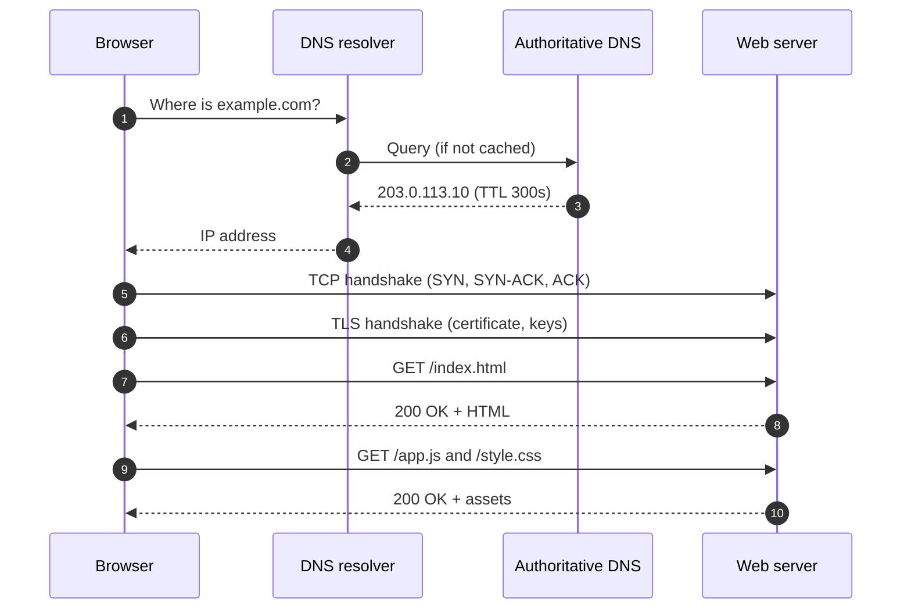
*Caption: a cold visit pays for DNS, TCP and TLS before any HTML arrives.*
**Animate:** send a signal along each arrow in order; show a running millisecond counter;
grey out steps 1-6 on a "repeat visit" toggle to show what caching and keep-alive remove.

### Flow steps
| # | From | To | Label | Detail |
| --- | --- | --- | --- | --- |
| 1 | Browser | DNS resolver | Resolve name | Browser and OS caches are checked first. |
| 2 | DNS resolver | Authoritative DNS | Recursive query | Skipped if the resolver has a cached answer. |
| 3 | Browser | Web server | TCP handshake | 1 RTT to open a reliable connection. |
| 4 | Browser | Web server | TLS handshake | 1 RTT with TLS 1.3. Verifies the certificate. |
| 5 | Browser | Web server | HTTP request | `GET /index.html` with headers. |
| 6 | Web server | Browser | HTTP response | Status, headers and HTML body. |
| 7 | Browser | Web server | Subresource requests | CSS, JS and images, in parallel. |

### Worked example
Assume RTT = 50 ms, uncached DNS = 30 ms, server processing = 20 ms, TLS 1.3.
- **Cold visit:** 30 (DNS) + 50 (TCP) + 50 (TLS) + 50 (request and response) + 20 (server) = **200 ms** to the first byte.
- **Warm visit** (DNS cached, connection reused): 50 + 20 = **70 ms**.

The server did the same work both times. Almost all of the difference is round trips.

### Trade-offs and decision rules
- Long DNS TTL means fewer lookups but slower failover. Short TTL means faster changes but more lookups.
- Reusing connections (keep-alive, HTTP/2) removes handshake cost.
- A CDN ends TLS close to the user, so the handshake round trips are short.

### Common mistakes
- Forgetting that DNS is a dependency that can fail or be slow.
- Believing HTTP is stateful. It is stateless; cookies and tokens add state on top.
- Treating HTTPS as protection for application logic. It protects data in transit only.

### Interview questions
1. **What happens when you type a URL and press Enter?**
   - Parse URL, DNS, TCP, TLS, HTTP request, server work, response, render.
   - Mention the cache that can short-circuit each step.
   - Mention parallel subresource fetching.
2. **Why is the first request slower than later ones?**
   - DNS, TCP and TLS handshakes are paid once per connection.
   - Caches are cold.
   - Fixes: keep-alive, HTTP/2 or 3, CDN, preconnect.
3. **What does HTTPS add over HTTP?**
   - Confidentiality, integrity and server authentication via TLS.
   - It does not make the application itself secure.

### Quick checks
- How many round trips pass before the first HTTP request can be sent on a fresh TCP + TLS 1.3 connection? **2.**
- What controls how long a DNS answer is cached? **The record's TTL.**

### Related topics
02, 03, 21 (CDN), Consistent Hashing and later distributed-systems lessons

---

## 02. Latency, throughput, and the numbers that matter

**Phase:** Foundations | **Level:** Beginner | **Read time:** 12 min | **Prerequisites:** 01

### Learning objectives
- Distinguish latency, throughput and bandwidth.
- Read percentiles (p50, p95, p99) and explain why averages mislead.
- Use Little's Law to relate traffic, latency and concurrency.
- Recall the order-of-magnitude cost of memory, disk and network operations.

### Plain-language explanation
Latency is how long one thing takes. Throughput is how many things get done per second.
A motorway can have high throughput (many cars per hour) while each trip is still slow.
Bandwidth is the size of the pipe; throughput is what you actually push through it.

### How it works
1. **Percentiles** sort all request times. p50 is the middle; p99 is the time that 99% of
   requests beat. The slowest 1% define the worst experience.
2. **Tail amplification**: a page that fans out to many backend calls is only as fast as its
   slowest call. With 20 parallel calls that are each slow 1% of the time, the chance that
   at least one is slow is 1 - 0.99^20 = about **18%**.
3. **Little's Law**: `L = λ × W`. Concurrent requests in flight (L) equal arrival rate (λ)
   times average time in system (W).
4. **Batching** raises throughput but adds latency, because work waits for the batch to fill.

### Key terms
Latency, throughput, bandwidth, percentile, tail latency, RTT, concurrency, queueing.

### Diagrams
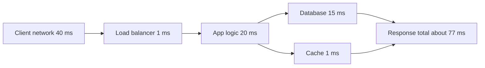
*Caption: a latency budget. Add up the path, then ask which hop is worth optimising.*
**Animate:** draw each box as a bar sized by its milliseconds; let the learner drag the
database bar to see the total change.

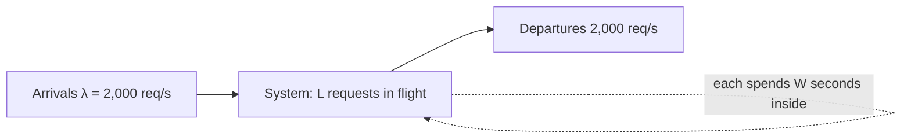
*Caption: Little's Law, L = λ × W.*
**Animate:** a slider for W; the count of dots inside the box rises as W grows.

Reference table (orders of magnitude, not guarantees):

| Operation | Approx. time |
| --- | --- |
| Main memory read | 100 ns |
| SSD random read | 100 µs |
| Round trip inside one datacenter | 0.5 ms |
| HDD seek | 10 ms |
| Cross-continent round trip | 100-150 ms |

Memory is roughly 1,000x faster than SSD; SSD is roughly 100x faster than an HDD seek.

### Worked example
At 2,000 req/s with W = 0.05 s: L = 2,000 × 0.05 = **100** requests in flight.
If a slow dependency pushes W to 0.5 s at the same arrival rate, L = **1,000**. Thread and
connection pools sized for 100 are now exhausted, so latency rises further. This is how a
small slowdown turns into an outage.

### Trade-offs and decision rules
- Optimise the tail (p99) for user-facing paths; optimise throughput for batch jobs.
- Batch when throughput matters more than per-item latency.
- Set pool sizes and timeouts using L = λ × W, not guesses.

### Common mistakes
- Reporting averages. A 50 ms average can hide a 2 s p99.
- Confusing bandwidth with throughput.
- Ignoring queueing: near full utilisation, latency grows sharply.

### Interview questions
1. **Why use p99 instead of the average?**
   - Averages hide the tail; users and fan-out calls experience the tail.
   - Percentiles cannot be averaged across hosts; aggregate raw histograms.
2. **Can you improve throughput at the cost of latency?**
   - Yes: batching, larger buffers, deeper queues.
   - Trade-off depends on whether the caller waits per item.
3. **What is tail latency amplification?**
   - Fan-out requests wait for the slowest call.
   - Example: 20 calls at 1% slow each means about 18% of pages are slow.
   - Mitigations: hedged requests, timeouts, fewer fan-out calls.

### Quick checks
- 500 req/s, average latency 0.2 s. How many requests are in flight? **100.**
- Why is memory vs SSD a useful ratio to remember? **It explains why caching helps: about 1,000x.**

### Related topics
01, 03, 17 (Cache), 35 (backpressure and load shedding)

---

## 03. The anatomy of a request

**Phase:** Foundations | **Level:** Beginner | **Read time:** 12 min | **Prerequisites:** 01, 02

### Learning objectives
- Follow one request through edge, load balancer, gateway, service, cache and database.
- Identify the parts of an HTTP request and response.
- Explain why timeouts must shrink as a request goes deeper.
- Describe how a trace ID connects logs across services.

### Plain-language explanation
A request is rarely answered by one machine. It passes through a series of helpers, each
with one job: find the nearest copy, pick a healthy server, check who you are, run the
logic, and fetch data. Knowing the stops tells you where time goes and where things break.

### How it works
1. **Request parts**: method and path, headers (`Host`, `Authorization`, `Content-Type`,
   trace ID such as `traceparent`), and an optional body.
2. **Response parts**: status class (2xx success, 3xx redirect, 4xx client error,
   5xx server error), headers and body.
3. **Cross-cutting work** at the gateway: authentication, rate limiting, validation,
   logging, adding a trace ID.
4. **Data access**: check the cache first, fall back to the database on a miss, then fill
   the cache with a TTL.
5. **Timeouts**: each layer's timeout must be shorter than its caller's, otherwise the
   caller gives up while the callee is still working.
6. **Retries** are safe only for idempotent operations (idempotency is covered in a later lesson).

### Key terms
Edge, load balancer, API gateway, middleware, cache hit and miss, status code, timeout,
trace ID, span.

### Diagrams
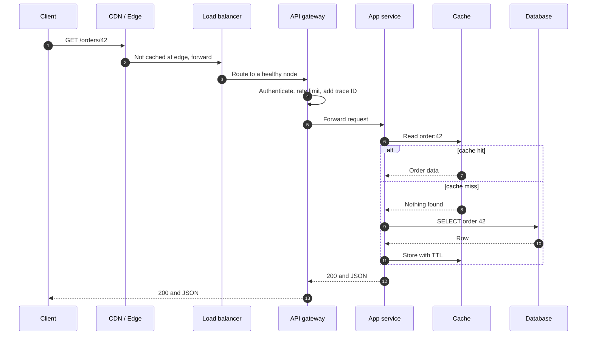
*Caption: the layers between a client and its data, with the cache hit and miss branches.*
**Animate:** a signal travels down and back up; on the `alt` block, toggle hit or miss and
show the miss path taking longer.

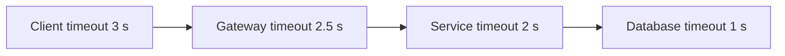
*Caption: timeouts shrink with depth so inner layers fail first and can return a clean error.*

### Flow steps
| # | From | To | Label | Detail |
| --- | --- | --- | --- | --- |
| 1 | Client | Edge | GET /orders/42 | The edge serves cacheable content directly. |
| 2 | Edge | Load balancer | Forward | Personalised responses are usually not cached at the edge. |
| 3 | Load balancer | Gateway | Route | Only healthy nodes receive traffic. |
| 4 | Gateway | Gateway | Cross-cutting checks | Auth, rate limit, validation, trace ID. |
| 5 | Gateway | App service | Forward | The trace ID travels in a header. |
| 6 | App service | Cache | Read | A hit ends the data work here. |
| 7 | App service | Database | Read on miss | Slower; the result fills the cache. |
| 8 | App service | Client | Response | Passes back through the gateway. |

### Worked example
Cache hit ratio 90%, cache read 1 ms, database read 15 ms:
expected data time = 0.9 × 1 + 0.1 × (1 + 15) = 0.9 + 1.6 = **2.5 ms**, versus 15 ms with no cache.

### Trade-offs and decision rules
- A gateway centralises auth and limits but is another hop and another failure point.
- Cache TTL trades freshness for load.
- Retry only idempotent requests, with backoff and a cap.

### Common mistakes
- Equal timeouts at every layer.
- Retrying non-idempotent writes.
- No trace ID, so a slow request cannot be followed across services.

### Interview questions
1. **Where can latency hide in a request?**
   - DNS and handshakes, queueing at the load balancer, gateway checks, cache misses,
     database queries, serialisation, and slow downstream calls.
2. **How do you debug a slow request across services?**
   - Propagate a trace ID, collect spans per hop, find the longest span.
   - Correlate logs with the same ID.
3. **What is the difference between 4xx and 5xx, and who retries?**
   - 4xx means the client sent something wrong; retrying the same request will not help.
   - 5xx means the server failed; retry may help if the operation is idempotent.

### Quick checks
- Why should the database timeout be shorter than the service timeout? **So the service can handle the failure and still reply before its caller gives up.**
- What does a cache miss cost beyond the cache read? **A database read plus a cache write.**

### Related topics
01, 02, 13 (Load Balancer), 23 (Reverse Proxy), 15 (API Gateway), 17 (Cache)

---

## 04. Storage primitives: files, rows, and documents

**Phase:** Foundations | **Level:** Beginner | **Read time:** 12 min | **Prerequisites:** 01

### Learning objectives
- Describe files or objects, relational rows and documents.
- Match a kind of data to the primitive that suits it.
- Explain why storage is read in pages, not single values.
- Model the same data relationally and as a document and compare the results.

### Plain-language explanation
Data comes in three everyday shapes. A **file** is a sealed box of bytes (a photo, a video).
A **row** is one line in a strict table, where every line has the same columns. A **document**
is a self-contained bundle, like a form with sections nested inside it. Choosing among them
is mostly about how you will ask questions of the data later.

### How it works
1. **Files and objects**: stored by name or key, read and written whole. Great for large,
   opaque data. Cannot query inside them without extra tooling.
2. **Relational rows**: typed columns, a schema enforced by the database, joins across
   tables, and multi-row transactions (ACID).
3. **Documents**: nested JSON-like records, flexible schema, read as a unit by key or by
   indexed field. Atomic updates usually apply to a single document.
4. **Pages**: disks and databases read fixed-size blocks, commonly 8-16 KB for relational
   engines. Reading one row reads its whole page, so data that is read together should sit
   together.

### Key terms
Object, row, column, schema, document, index, transaction, page, key-value.

### Diagrams
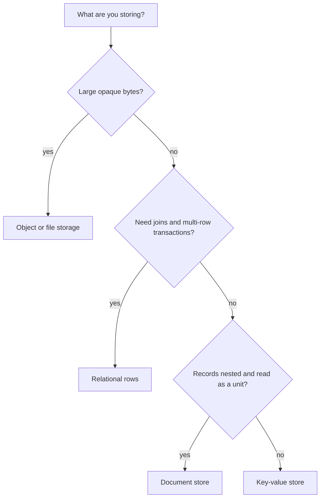
*Caption: a first-pass decision tree. Real systems often use more than one.*
**Animate:** let the learner click an example (profile photo, bank transfer, product catalogue
entry, session token) and highlight the path to the answer.

| | File / object | Relational row | Document |
| --- | --- | --- | --- |
| Shape | Opaque bytes plus metadata | Typed columns | Nested, flexible |
| Query by | Key or path | SQL, joins, indexes | Key, plus indexed fields |
| Transactions | Per object | Multi-row ACID | Usually per document |
| Best for | Images, video, backups | Orders, payments, accounts | Catalogues, profiles, content |
| Watch out for | No partial queries | Schema migrations, write scaling | Duplication, weak joins |

### Worked example
An order with 3 items.
- **Relational:** `orders(id, user_id, total)` and `order_items(order_id, product_id, qty, price)`.
  Revenue by product is one SQL query. Rendering the order page needs a join.
- **Document:** one `order` document with `items: [...]` embedded. Rendering the page is one
  read. Revenue by product needs scanning documents or a separate index.

Neither is wrong. The right choice follows the dominant access pattern.

### Trade-offs and decision rules
- Start relational when relationships and transactions matter.
- Use documents when data is read as one unit and the shape varies.
- Keep large blobs in object storage and store only their keys in the database.

### Common mistakes
- Storing images inside database rows.
- Choosing a store from fashion instead of access patterns.
- Embedding data that is updated independently, creating duplicates that drift.

### Interview questions
1. **When would you pick a document store over a relational database?**
   - Nested data read as a unit, varying shape, simple key lookups.
   - Not when you need many cross-record joins or multi-row transactions.
2. **Why not store images in the database?**
   - Large blobs bloat pages and backups, and slow queries.
   - Object storage is cheaper, scales out, and pairs well with a CDN.
3. **What is a page and why does it matter?**
   - The unit of disk and memory I/O, so locality of related data reduces reads.

### Quick checks
- A bank transfer touches two accounts. Which primitive fits? **Relational rows with a transaction.**
- Where should a 4 MB profile photo live? **Object storage, with its key in the database.**

### Related topics
16 (Database), plus the Database Indexing and Object Storage specs (no card yet)

---

## 05. APIs as contracts

**Phase:** Foundations | **Level:** Beginner | **Read time:** 12 min | **Prerequisites:** 03

### Learning objectives
- Explain an API as a promise between independent teams.
- Design resource names, errors and pagination that clients can rely on.
- Classify a change as breaking or non-breaking.
- Describe contract-first development with an OpenAPI spec.

### Plain-language explanation
An API is a written promise: "send me this, and I will answer with that." Once other people
build on it, you cannot change the promise freely. Good API design is mostly about making
promises you can keep for years.

### How it works
1. **A contract covers**: endpoints, input shape, output shape, error shape, meaning
   (semantics), limits, and compatibility rules.
2. **Styles**: REST (resources over HTTP), RPC and gRPC (calls with typed messages),
   GraphQL (client chooses fields). Pick by consumer needs, not trend.
3. **Pagination**: offset (`?page=3`) is simple but drifts when data changes and gets slow
   deep in a list; cursor (`?after=abc`) is stable and efficient.
4. **Errors**: one consistent shape with a stable machine-readable code.
5. **Idempotency**: unsafe operations accept an `Idempotency-Key` so retries do not repeat
   the effect.
6. **Versioning**: add optional things freely; removing or changing meaning needs a new
   version or a deprecation window.
7. **Contract-first**: write the spec, generate server stubs, clients and validators from it.

Example error shape:
```json
{ "error": { "code": "ORDER_NOT_FOUND", "message": "Order 42 does not exist", "requestId": "req_8f2c" } }
```

### Key terms
Contract, resource, idempotency, pagination, cursor, versioning, backward compatibility,
OpenAPI, schema validation.

### Diagrams
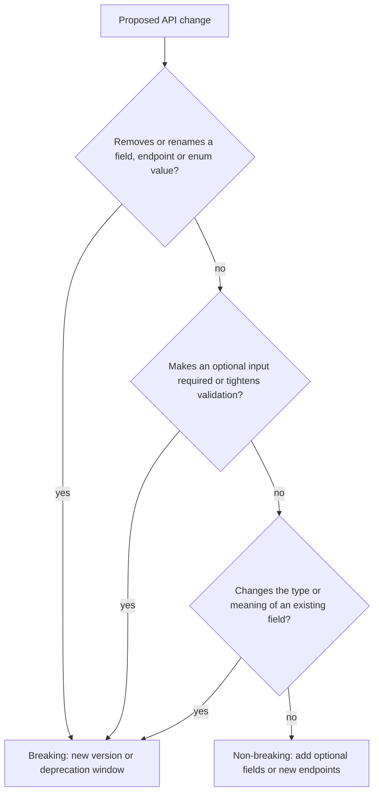
*Caption: a breaking-change checklist.*
**Animate:** give the learner five sample changes to drop onto the tree.

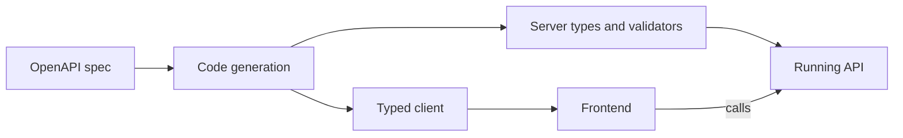
*Caption: contract-first. This repository does exactly this with `lib/api-spec`, Orval,
`lib/api-zod` and `lib/api-client-react`, so it can serve as a live example.*

### Worked example
A list endpoint with 1,000,000 rows, page size 50.
- Offset: `?offset=999950` makes the database count past 999,950 rows to return 50.
- Cursor: `?after=<last_id>` uses an index to jump to the position directly.
Cursor cost stays roughly flat as the list grows; offset cost grows with depth.

### Trade-offs and decision rules
- REST for public, cacheable resources; gRPC for internal service-to-service calls;
  GraphQL when many clients need different shapes.
- Be strict in what you send and tolerant in what you accept.
- Treat any shipped field as permanent.

### Common mistakes
- Returning different error shapes from different endpoints.
- Using offset pagination on large, changing lists.
- Making a previously optional field required.

### Interview questions
1. **What makes a change to an API breaking?**
   - Removing or renaming something, tightening validation, or changing meaning or type.
   - Adding optional fields is generally safe.
2. **Offset vs cursor pagination?**
   - Offset: simple, drifts under writes, slow deep in a list.
   - Cursor: stable, fast, harder to jump to arbitrary pages.
3. **Why does an idempotency key matter?**
   - Retries after a timeout would otherwise repeat the side effect, such as a double charge.

### Quick checks
- Is adding a new optional response field breaking? **No.**
- What should every error response include? **A stable code, a message and a request ID.**

### Related topics
03, 14 (API), 15 (API Gateway)

---

## 06. Reliability, availability, and durability

**Phase:** Foundations | **Level:** Beginner | **Read time:** 14 min | **Prerequisites:** 02

### Learning objectives
- Separate reliability, availability and durability.
- Convert "nines" into minutes of downtime.
- Calculate availability for components in series and in parallel.
- Find single points of failure in a diagram.

### Plain-language explanation
**Reliability** means it does the right thing. **Availability** means it answers when you ask.
**Durability** means what you saved is still there. A service can be up but wrong, or down but
safe. They are different promises and need different engineering.

### How it works
1. **Availability** = uptime ÷ total time. Also `MTBF ÷ (MTBF + MTTR)`.
2. **Series** (every part must work): multiply availabilities.
3. **Parallel** (any one part may serve): unavailability multiplies, so
   `A = 1 - (1 - a)^n`, assuming failures are independent.
4. **Single point of failure (SPOF)**: any component with no redundant partner.
5. **Failure handling**: health checks detect, load balancers or failover route around,
   replication protects data.
6. **Durability** comes from copies (replication, erasure coding) and backups, not from
   availability. Object stores often quote designs of about "11 nines" of durability.

### Key terms
Availability, reliability, durability, nines, MTBF, MTTR, SPOF, redundancy, failover,
health check, SLA.

### Diagrams
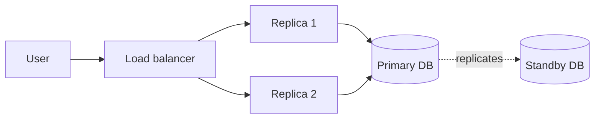
*Caption: two replicas look redundant, but the load balancer and the primary database are still single points of failure.*
**Animate:** let the learner click a node to "fail" it; the diagram shows whether the user
still gets served.

Availability and downtime (per year, per 30-day month):

| Availability | Per year | Per 30-day month |
| --- | --- | --- |
| 99% | 3.65 days | 7.2 hours |
| 99.9% | 8.76 hours | 43.2 minutes |
| 99.95% | 4.38 hours | 21.6 minutes |
| 99.99% | 52.6 minutes | 4.32 minutes |
| 99.999% | 5.26 minutes | 26 seconds |

### Worked example
- **Series:** two services at 99.9% each: 0.999 × 0.999 = 0.998 = **99.8%**. Chaining dependencies lowers availability.
- **Parallel:** two independent replicas at 99.9%: 1 - 0.001² = 0.999999 = **99.9999%**.
- **MTTR:** MTBF = 1,000 h and MTTR = 1 h gives 1,000 ÷ 1,001 = **99.9%**. Cutting MTTR to 6 minutes gives about 99.99%.

The catch in the parallel case: replicas that share a rack, a bug, a deploy or a dependency
fail together, so real availability is lower.

### Trade-offs and decision rules
- Each extra nine costs disproportionately more. Choose the target from business impact.
- Faster recovery (lower MTTR) is often cheaper than fewer failures.
- Spread replicas across failure domains: host, rack, availability zone.

### Common mistakes
- Quoting 99.99% without counting dependencies in series.
- Treating replicas as independent when they share a failure domain.
- Confusing a backup with high availability.

### Interview questions
1. **How much downtime does 99.99% allow?**
   - About 52.6 minutes a year, or 4.3 minutes a 30-day month.
2. **How do you remove single points of failure?**
   - Redundancy at every layer (including the load balancer and database), health checks, automatic failover, multiple availability zones.
3. **What is the difference between availability and durability?**
   - Availability is about serving requests now; durability is about not losing stored data.
   - A system can be one without the other.

### Quick checks
- Three dependencies in series, each 99.9%. Overall? **About 99.7%** (0.999³ = 0.997).
- Name two SPOFs in the diagram above. **The load balancer and the primary database.**

### Related topics
02, 13 (Load Balancer), the Replication spec (no card yet), and later reliability lessons

---

## 07. A practical capacity planning primer

**Phase:** Foundations | **Level:** Beginner | **Read time:** 14 min | **Prerequisites:** 02, 06

### Learning objectives
- Turn daily users into average and peak requests per second.
- Estimate storage and bandwidth with replication included.
- Size a server fleet with headroom and zone-failure tolerance.
- State and defend assumptions out loud.

### Plain-language explanation
Capacity planning is arithmetic with honest assumptions. You do not need exact numbers; you
need the right order of magnitude, so you do not build for 100 users when 10 million are
coming, or the reverse.

### How it works
1. **Requests**: DAU × requests per user per day ÷ 86,400 s = average QPS.
2. **Peak**: multiply by a peak factor (commonly 2-3x, more for spiky products).
3. **Storage**: new records per day × size × retention days × replication factor.
4. **Bandwidth**: peak QPS × response size.
5. **Fleet size**: peak QPS ÷ per-instance capacity ÷ target utilisation.
6. **Headroom**: plan to survive the loss of a zone while staying under the utilisation target.

Handy constants: 86,400 seconds per day, about 2.5 million seconds per month,
1 million requests per day is about 12 QPS.

### Key terms
DAU, QPS, peak factor, replication factor, utilisation, headroom, back-of-envelope.

### Diagrams
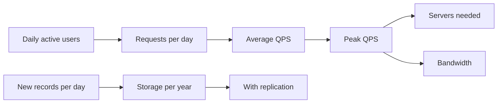
*Caption: three estimate chains: traffic, bandwidth and storage.*
**Animate:** editable input boxes at the left of each chain that recompute everything to the right.

### Worked example
Assumptions: 10 M DAU, 20 requests per user per day, peak factor 3, response 10 KB, one
instance handles 500 QPS, target utilisation 70%, three zones.
- Daily requests: 10 M × 20 = 200 M.
- Average QPS: 200 M ÷ 86,400 ≈ **2,315**.
- Peak QPS: 2,315 × 3 ≈ **7,000**.
- Bandwidth: 7,000 × 10 KB = 70 MB/s = **560 Mbps**.
- Instances at 70%: 7,000 ÷ 500 ÷ 0.7 = **20**.
- Surviving one of three zones: the remaining two zones must hold those 20, so total = 20 × 3 ÷ 2 = **30** (10 per zone). Check: lose a zone, 20 remain, each at 7,000 ÷ 20 = 350 QPS = 70% of 500. ✓

Storage: 1 M new posts per day × 1 KB = 1 GB/day. Over a year: 365 GB. With 3 replicas: about **1.1 TB** (before indexes and overhead).

### Trade-offs and decision rules
- Round aggressively and use powers of ten; precision here is false precision.
- Plan for peak, not average.
- Keep utilisation well below 100%; queues grow sharply near saturation.

### Common mistakes
- Sizing for average traffic.
- Forgetting replication, indexes and growth.
- Running at 90-100% utilisation, leaving no room for failure or spikes.

### Interview questions
1. **Estimate the QPS for 10 million daily users.**
   - State assumptions (requests per user), divide by 86,400, apply a peak factor.
2. **How much headroom do you leave and why?**
   - Roughly 30-40% for spikes and failures; queueing makes high utilisation fragile.
3. **How does losing a zone affect capacity planning?**
   - Remaining zones must carry full peak load within the utilisation target, so total capacity is N/(N-1) times larger.

### Quick checks
- 1 M requests per day is about how many QPS? **About 12.**
- Why plan 30 instances when 20 meet the target? **To survive a zone failure.**

### Related topics
02, 06, 57 (capacity planning for growth), 71-80 (case studies use these steps)

---

## 08. Designing your first service boundary

**Phase:** Foundations | **Level:** Beginner | **Read time:** 12 min | **Prerequisites:** 03, 05, 06

### Learning objectives
- Draw a boundary around a business capability and the data it owns.
- Spot a shared-database anti-pattern.
- Apply a short checklist to decide whether something should be its own service.
- Explain why modules inside one codebase are often the right first step.

### Plain-language explanation
A service boundary is a line that says "this part owns these decisions and this data; talk to
it only through its API." A good line lets a team change its side without asking everyone
else. A bad line creates services that must always change and deploy together.

### How it works
1. **Cut by business capability** (Orders, Catalog, Payments), not by technical layer
   ("UI service", "database service").
2. **Own the data**: a service's tables are private. Others use its API.
3. **Keep the API small** relative to the logic behind it.
4. **Boundary checklist**: does it own distinct data? Can it change and deploy on its own?
   Does it have a clear owner? Does it scale or fail differently? Is cross-boundary chatter low?
5. **Start with modules**: enforce the same boundaries inside one codebase first. Split into
   network services only when a real need appears.

### Key terms
Service boundary, bounded context, data ownership, coupling, cohesion, chatty service,
distributed monolith.

### Diagrams
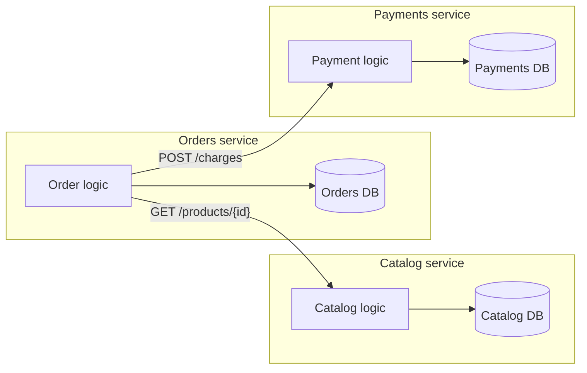
*Caption: each service owns its data; calls cross boundaries only through APIs.*
**Animate:** replay a "place order" request across the three services, highlighting each API call.

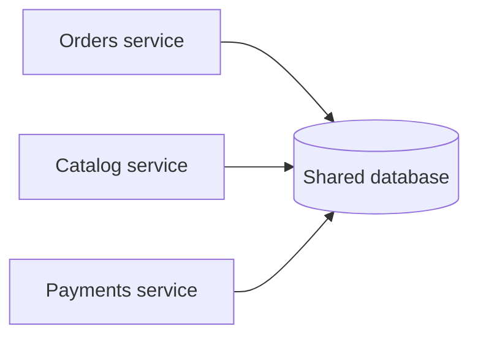
*Caption: the anti-pattern. Any schema change can break all three services.*

### Worked example
Online store, first draft: Orders, Catalog, Payments.
- Placing an order: Orders calls Catalog for price and stock, calls Payments to charge, then
  stores the order in its own database.
- Reports need data from all three. Instead of reading their tables, build a read model
  fed by events or API calls (see lessons 46 and 48).
- Test of the boundary: if a pricing rule change forces edits in all three services, the
  boundary is in the wrong place.

### Trade-offs and decision rules
- Fewer, larger boundaries are easier to run; smaller ones give independence at the cost of
  network calls, partial failure and distributed transactions.
- Split when teams, scaling needs or failure isolation clearly demand it.
- If two services always change together, merge them.

### Common mistakes
- Splitting by technical layer.
- Sharing one database across services.
- Chatty services that make a dozen calls per request, forming a distributed monolith.
- Splitting early, before the domain is understood.

### Interview questions
1. **How do you decide service boundaries?**
   - Business capability, data ownership, change cadence, team ownership, failure isolation.
2. **Why is a shared database an anti-pattern?**
   - It couples services through the schema, so changes cannot be made or deployed independently.
3. **When should you not split into services?**
   - Small team, unclear domain, no independent scaling need. A modular monolith is often better.

### Quick checks
- Which of these is a bad boundary: Orders, Payments, "Database Layer"? **"Database Layer", it is a technical layer, not a capability.**
- Two services always deploy together. What does that suggest? **They should probably be one.**

### Related topics
05, 22 (Service Discovery), 41-44 (architecture patterns), 49 (strangler migration)
