# Phase 2: Core Building Blocks (live lessons 09-24)

Read the curriculum guide first. All numbers are approximate unless stated.

## Scope decision (revised)

This spec is keyed to the lesson numbers and titles in `building-blocks/lessons.ts`.
**Section NN of this file is live card NN.** Earlier versions of this file used a different
list; that list is retired.

The cards are accordion entries keyed by lesson ID, not slug-based routes. Keep every
card's title and its analogy. Extend the card; do not replace it.

| Live card | Title on the page | Spec content |
| --- | --- | --- |
| 09 | How Does the Internet Actually Work? | Deepens the card (already implemented) |
| 10 | Client & Server | New spec |
| 11 | DNS (The Internet's Phone Book) | New spec |
| 12 | What Happens When You Press Enter? | New spec (browser side) |
| 13 | Load Balancer (The Traffic Police) | Deepens the card |
| 14 | API (The Waiter) | Deepens the card (REST design) |
| 15 | API Gateway | Deepens the card |
| 16 | Database (The Library) | Deepens the card (SQL vs NoSQL) |
| 17 | Cache (Sticky Notes) | Deepens the card |
| 18 | Redis | Deepens the card |
| 19 | Message Queue (The Waiting Line) | Deepens the card |
| 20 | Kafka | Deepens the card |
| 21 | CDN (Delivery Warehouse) | Deepens the card |
| 22 | Service Discovery | Deepens the card |
| 23 | Reverse Proxy | Deepens the card |
| 24 | Putting Everything Together | New spec (capstone) |

### Rules for implementing from this file

1. Lesson NN is built from section NN. Never pull content from a section with another number.
2. Keep the card's existing title. Where a card title carries an analogy (Traffic Police,
   Waiter, Library, Sticky Notes, Waiting Line, Delivery Warehouse, Phone Book), lead the
   plain-language explanation with that analogy and keep the card's existing text where it
   is still correct. Each section's "Existing card covers" line says what is already there.
3. Cards 09, 10, 11 and 12 overlap. Keep this split so they do not repeat each other:
   - 09 = layers and protocols (IP, TCP, UDP, HTTP, TLS). Already implemented; leave it.
   - 10 = roles, state and connection styles.
   - 11 = turning names into addresses (DNS in depth).
   - 12 = the whole journey from keypress to pixels, focused on the browser. It summarises
     the network steps and points to 09 and 11 instead of repeating them.
4. Card 24 is a capstone built from the other cards. Implement it last.
5. Suggested order: 10, 11, 12, then 13-23 in numeric order, then 24.

### Specs with no live card yet

Four sections were written for topics that have no card. They are at the end of this file
under "Unplaced sections": Database Indexing, Replication, Sharding & Partitioning and
Object Storage (Amazon S3). **Do not implement them yet.** Placement (extra cards after 24,
a separate group, or a later phase) is the author's decision. They must not take card
numbers 25 or above, because lesson 25 is the authored Consistent Hashing page.

### Roadmap topics with no lesson

`roadmap.ts` lists these for 09-24 but no live card covers them. Do not delete them; place
them later: transactions and isolation, cache invalidation strategies (partly covered in
17), pub/sub and event streams (partly covered in 19 and 20), rate limiting algorithms
(used by 15 and 18), search indexes, distributed locks and leases, idempotency and safe
retries, the service boundary workshop. Suggested first addition: **rate limiting
algorithms**.

### Known numbering conflict

The authored page `/content/consistent-hashing` is "Lesson 25: Consistent Hashing", but
`roadmap.ts` lists 25 as "The fallacies of distributed computing". Refer to it by title
until Phase 3 is specified.

### Cross-reference fixes needed in `01-foundations.md` (second round)

The Foundations spec currently carries the previous round of fixes, which used the retired
numbering. Replace as follows so links match the live cards:

| Spec | Find | Replace with |
| --- | --- | --- |
| 02 | `14 (caching)` | `17 (Cache)` |
| 03 | `11 (Load Balancers), 12 (Reverse Proxy), 13 (API Gateway), 14 (Caching Fundamentals)` | `13 (Load Balancer), 23 (Reverse Proxy), 15 (API Gateway), 17 (Cache)` |
| 04 | `16 (Databases: SQL vs NoSQL), 17 (Database Indexing), 20 (Object Storage)` | `16 (Database), plus the Database Indexing and Object Storage specs (no card yet)` |
| 05 | `03, 10 (REST APIs & API Design), 13 (API Gateway)` | `03, 14 (API), 15 (API Gateway)` |
| 06 | `02, 11 (Load Balancers), 18 (Replication), and later reliability lessons` | `02, 13 (Load Balancer), the Replication spec (no card yet), and later reliability lessons` |
| 08 | `05, 24 (Service Discovery), 41-44 (architecture patterns), 49 (strangler migration)` | `05, 22 (Service Discovery), 41-44 (architecture patterns), 49 (strangler migration)` |

Spec 01 (`21 (CDN)`) and spec 07 need no change.

---

## 09. How Does the Internet Actually Work?

**Level:** Beginner to intermediate | **Read time:** 15 min | **Prerequisites:** Foundations 01

**Existing card covers:** the request-response journey from a phone through the Internet to a server and back. Already implemented; this spec adds layers, protocols and TCP behaviour. Keep the card title and extend it.

### Learning objectives
- Place DNS, TCP, UDP, IP, HTTP and TLS on the layered model.
- Explain what makes TCP reliable and why UDP exists.
- Compare HTTP/1.1, HTTP/2 and HTTP/3.
- Explain how a certificate lets a browser trust a server.

### Plain-language explanation
Networking is a stack of simple promises. The bottom layer moves bits between neighbours.
IP moves packets across many networks. TCP turns lossy packets into a reliable stream.
HTTP uses that stream to ask for and send web resources, and TLS keeps the conversation private.

### How it works
1. **Layers**: application (HTTP, DNS), transport (TCP, UDP), internet (IP), link (Ethernet, Wi-Fi).
2. **IP and ports**: an IP address finds the machine; a port finds the program (443 HTTPS, 80 HTTP, 53 DNS). IPv4 is 32-bit, IPv6 is 128-bit.
3. **TCP**: ordered, reliable stream using sequence numbers, acknowledgements, retransmission, receiver flow control and congestion control.
4. **UDP**: no handshake, no delivery guarantee, low overhead. Used by DNS queries, real-time media and QUIC.
5. **DNS records**: A (IPv4), AAAA (IPv6), CNAME (alias), NS (name servers), MX (mail), TXT (verification and policy).
6. **HTTP versions**: 1.1 handles one request at a time per connection. HTTP/2 multiplexes many streams on one TCP connection. HTTP/3 uses QUIC over UDP, so one lost packet no longer stalls every stream.
7. **TLS**: the server presents a certificate signed by a trusted authority; client and server agree on keys; data is then encrypted symmetrically. SNI lets one IP serve many hostnames.

### Key terms
Packet, port, socket, handshake, window, congestion control, record type, certificate, SNI.

### Diagrams
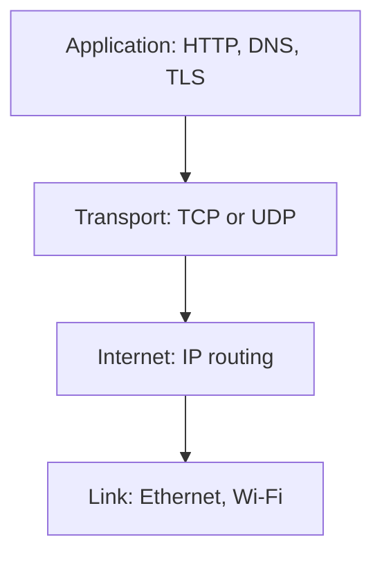
*Caption: each layer relies only on the one beneath it.*
**Animate:** wrap a message in a header at each layer going down, unwrap going up.

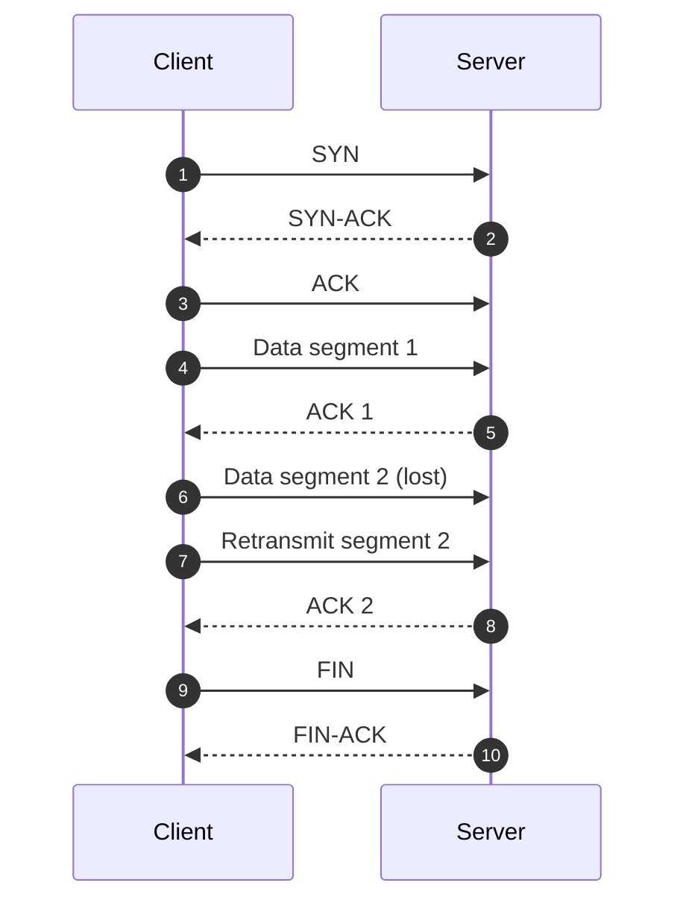
*Caption: TCP opens, recovers from a loss, and closes.*
**Animate:** drop the segment-2 arrow midway and replay it as a retransmission.

### Flow steps
| # | From | To | Label | Detail |
| --- | --- | --- | --- | --- |
| 1 | Client | Server | SYN | Starts the connection and proposes a sequence number. |
| 2 | Server | Client | SYN-ACK | Accepts and proposes its own number. |
| 3 | Client | Server | ACK | The connection is open. |
| 4 | Client | Server | Data | Segments carry sequence numbers. |
| 5 | Client | Server | Retransmit | A missing ACK triggers a resend. |
| 6 | Client | Server | FIN | Orderly close. |

### Worked example
TCP throughput is bounded by `window ÷ RTT`. With a 64 KB window and 50 ms RTT:
65,536 B ÷ 0.05 s ≈ 1.31 MB/s ≈ **10.5 Mbps**, however fast the link is. Window scaling raises the window so long, fast paths can be filled.

### Trade-offs and decision rules
- TCP for correctness; UDP when late data is useless or you build your own reliability.
- HTTP/2 and HTTP/3 cut connection overhead for pages with many assets.
- Always use TLS for anything user-facing.

### Common mistakes
- Assuming a fast link means a fast transfer. Latency and window size matter.
- Putting a CNAME at a zone apex where it is not allowed.
- Letting certificates expire.

### Interview questions
1. **TCP vs UDP?**
   - TCP: connection, ordering, retransmission, congestion control. UDP: none of these, lower latency.
2. **What does HTTP/2 improve over HTTP/1.1?**
   - Multiplexing on one connection, header compression; HTTP/3 also removes TCP head-of-line blocking.
3. **How does TLS establish trust?**
   - Certificate chain to a trusted authority, then key agreement, then symmetric encryption.

### Quick checks
- Which layer picks the program on a machine? **Transport, via the port.**
- Why is a CNAME handy? **It aliases one name to another so the target can change IPs.**

### Related topics
Foundations 01, 11 (DNS), 12 (What Happens When You Press Enter?), 13 (Load Balancer), 14 (API), 21 (CDN)

---

## 10. Client & Server

**Level:** Beginner | **Read time:** 12 min | **Prerequisites:** Foundations 01, 03

**Existing card covers:** what clients ask for and what servers do with requests and responses. Keep the card title and extend it.

### Learning objectives
- Explain client and server as roles in a conversation, not types of machine.
- Describe how a server handles many requests at once and what limits it.
- Distinguish stateless from stateful servers and say why it matters for scaling.
- Choose between request-response, polling, server-sent events and WebSockets.

### Plain-language explanation
A client is whoever asks; a server is whoever answers. Your phone is a client when it asks for a page. The program that serves that page becomes a client itself when it asks a database for data. The words describe the role in one conversation, not the machine.

### How it works
1. **Roles**: the client starts the conversation; the server listens on a port and accepts connections. One program can be a server to its callers and a client of other services.
2. **Kinds of client**: browsers, mobile apps, command-line tools, devices, and other servers calling services.
3. **Server loop**: accept a connection, parse the request, route it, run the handler, write the response.
4. **Handling many requests**: process per request, thread per request or thread pool, or an event loop with asynchronous I/O. The model decides how many simultaneous requests one machine can hold.
5. **Stateless server**: remembers nothing about a user between requests, so any server can answer any request. State lives in the client (a signed token) or a shared store.
6. **Stateful server**: keeps per-user data in its own memory, so a user must keep returning to the same server (sticky routing), which complicates scaling and failure.
7. **Identity across requests**: a session cookie points to server-side data in a shared store, or the client carries a signed token on every request.
8. **Beyond request-response**: polling and long polling (client keeps asking), server-sent events (server streams to the client), WebSockets (persistent two-way channel).
9. **Trust**: the client is outside your control. Validate and authorise everything on the server.

### Key terms
Client, server, role, port, stateless, stateful, session, cookie, token, WebSocket, server-sent events, long polling.

### Diagrams
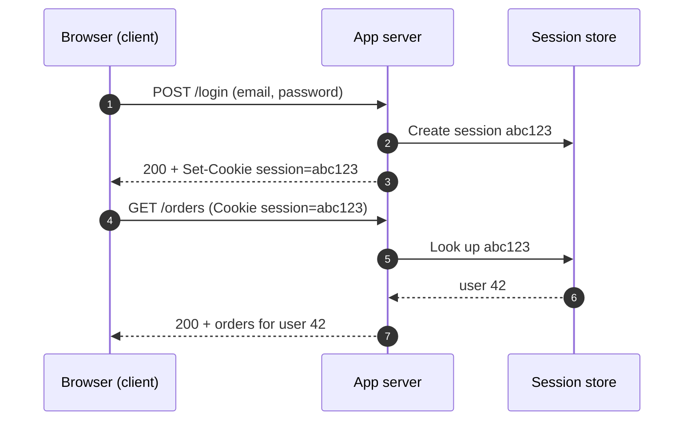
*Caption: the session lives in a shared store, so any server can answer the second request.*
**Animate:** send the second request to a different server instance and show it still works.

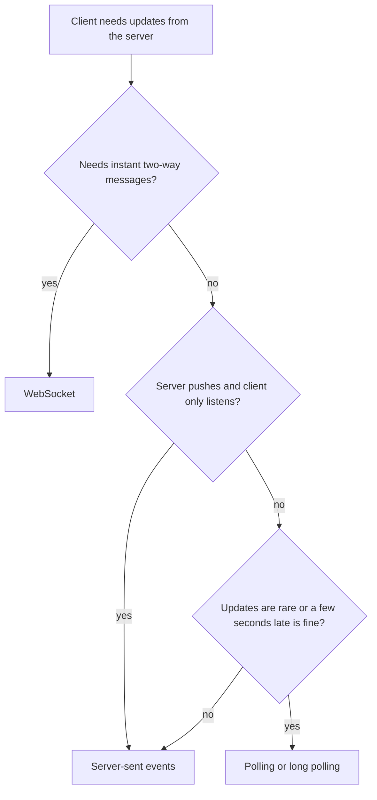
*Caption: picking a connection style.*
**Animate:** let the learner click a scenario (chat, stock ticker, order status page, nightly report) and follow the path.

### Flow steps
| # | From | To | Label | Detail |
| --- | --- | --- | --- | --- |
| 1 | Browser | App server | Login request | Credentials sent over TLS. |
| 2 | App server | Session store | Create session | State stored outside the server. |
| 3 | App server | Browser | Set-Cookie | Browser stores the session ID. |
| 4 | Browser | App server | Request with cookie | Sent automatically on every call. |
| 5 | App server | Session store | Look up session | Any server instance can do this. |
| 6 | App server | Browser | Response | Personalised for user 42. |

### Worked example
A server has a pool of 200 worker threads and each request holds a thread for 100 ms while it waits on the database. Maximum throughput = threads ÷ time held (Little's Law rearranged): 200 ÷ 0.1 = **2,000 requests/s**.
If the database slows and each request now holds a thread for 500 ms: 200 ÷ 0.5 = **400 requests/s**. The same machine handles five times less.
Session memory: 1 M logged-in users × 2 KB = **2 GB**. Kept in each server's memory it forces sticky routing; kept in a shared store any server can serve any user.

### Trade-offs and decision rules
- Prefer stateless servers; they scale out and recover simply.
- Use polling for rare updates, server-sent events for one-way streams, WebSockets for true two-way messaging.
- Persistent connections cost memory per connection; plan capacity for them.

### Common mistakes
- Session data in server memory behind a load balancer with no sticky routing.
- Trusting client-side validation.
- Polling every second when a push connection would do.

### Interview questions
1. **What makes a server stateless and why does it matter?**
   - No per-user memory between requests; any instance can answer; easy to scale and replace.
2. **How does one server handle thousands of connections?**
   - Event-loop or asynchronous I/O, or a sized thread pool; capacity follows from concurrency and time per request.
3. **Polling vs WebSockets vs server-sent events?**
   - Polling is simple but wasteful; SSE is one-way push over HTTP; WebSockets are two-way and persistent.

### Quick checks
- Can a web server also be a client? **Yes, when it calls another service or a database.**
- Where should session data live so any server can answer? **In a shared store or in a signed token the client carries.**

### Related topics
Foundations 03, 09, 13 (Load Balancer), 14 (API)

---

## 11. DNS (The Internet's Phone Book)

**Level:** Beginner to intermediate | **Read time:** 15 min | **Prerequisites:** 09

**Existing card covers:** how DNS translates domain names into IP addresses. Keep the Phone Book analogy and extend it. Lesson 09 only touches DNS in passing; this lesson is the focused one.

### Learning objectives
- Trace a lookup through resolver, root, TLD and authoritative servers.
- Read the common record types.
- Reason about TTL and caching when changing records.
- Use DNS for failover and traffic steering, and name its limits.

### Plain-language explanation
Computers find each other by number, people remember names. DNS is the phone book that turns `www.example.com` into an address. Nobody keeps the whole book: a chain of helpers each knows one part, and answers are remembered for a while so the next person does not have to repeat the search.

### How it works
1. **Hierarchy**: a name is read right to left. The root knows the top-level domains (`.com`), the TLD servers know who handles `example.com`, and that domain's **authoritative** servers hold the real records.
2. **Resolution**: the browser or operating system asks a **recursive resolver** (from the ISP or a public service). The resolver asks root, then TLD, then authoritative, and caches each answer.
3. **Record types**: A (name to IPv4), AAAA (IPv6), CNAME (alias to another name; not allowed at the zone apex by the standard), NS (which servers are authoritative), MX (mail), TXT (verification and email policy), SRV (service location).
4. **TTL**: how many seconds an answer may be cached. Failed lookups (NXDOMAIN) are cached too.
5. **Traffic steering**: several A records (round robin), weighted, latency-based or geo-based answers, and health-checked failover, all provider features.
6. **Limits of DNS steering**: clients and resolvers cache answers, so changes only take effect as old TTLs expire. DNS does not know the real load of a server.
7. **Security**: classic DNS is plaintext on UDP port 53 and can be spoofed. DNSSEC signs records; DNS over HTTPS or TLS encrypts queries.
8. **Failure modes**: resolver outage, expired domain, wrong NS records, a very long TTL on a bad record.

### Key terms
Resolver, root server, TLD, authoritative server, record, TTL, NXDOMAIN, CNAME, zone apex, DNSSEC.

### Diagrams
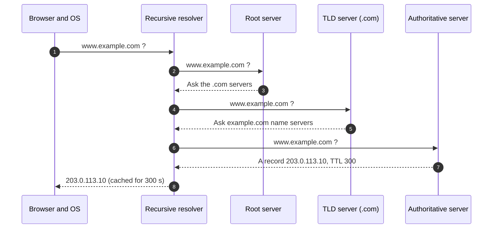
*Caption: an uncached lookup walks the hierarchy; the result is cached for its TTL.*
**Animate:** run the lookup twice; the second time the resolver answers from cache and skips steps 2-7.

### Flow steps
| # | From | To | Label | Detail |
| --- | --- | --- | --- | --- |
| 1 | Browser | Resolver | Ask for the name | Browser and OS caches are checked first. |
| 2 | Resolver | Root server | Ask about .com | Root points to the TLD servers. |
| 3 | Resolver | TLD server | Ask about example.com | TLD points to the name servers. |
| 4 | Resolver | Authoritative server | Ask for the record | This server holds the real answer. |
| 5 | Authoritative server | Resolver | Answer with TTL | Resolver caches it. |
| 6 | Resolver | Browser | Return the IP | Browser connects to that address. |

### Worked example
Lookup time, assuming 5 ms from the device to its resolver and 30 ms from the resolver to each server:
- Uncached: 5 + 3 × 30 = **95 ms**.
- Cached at the resolver: **about 5 ms**.

Migration plan for moving a site to a new IP when the record has TTL 86,400 s (24 h):
1. At least 24 h before the move, lower the TTL to 300 s.
2. Change the record. Stale answers now last at most 5 minutes.
3. Raise the TTL again once the move is stable.

### Trade-offs and decision rules
- Long TTL: fewer lookups, slower changes. Short TTL: faster changes and failover, more lookups.
- Use DNS steering for coarse regional routing; use a load balancer for real load distribution.
- Keep at least two authoritative name servers on separate networks.

### Common mistakes
- Changing a record without lowering the TTL first.
- Putting a CNAME at the zone apex.
- Letting the domain registration expire.

### Interview questions
1. **How does DNS resolution work?**
   - Stub to recursive resolver, then root, TLD, authoritative; caching at every level by TTL.
2. **A record vs CNAME?**
   - A maps a name to an address; CNAME makes one name an alias of another.
3. **Can DNS be used for failover and what is the catch?**
   - Yes, with health checks and short TTLs, but caching means the switch is never instant.

### Quick checks
- What controls how long an answer is cached? **The record's TTL.**
- Which server holds the real records for a domain? **Its authoritative name server.**

### Related topics
09, 12, 13 (Load Balancer), 21 (CDN)

---

## 12. What Happens When You Press Enter?

**Level:** Beginner to intermediate | **Read time:** 15 min | **Prerequisites:** 09, 11

**Existing card covers:** the browser's journey through DNS to a server, the response, and page rendering. Keep the card title and extend it. This lesson summarises the network steps and points to cards 09 and 11. Its new material is what the browser does before the request and after the response arrives. The network half is also specified in `01-foundations.md` (topic 01).

### Learning objectives
- Narrate the whole journey from keypress to pixels in order.
- Name the browser's rendering steps: DOM, CSSOM, render tree, layout, paint, composite.
- Identify what blocks rendering and how to avoid it.
- Connect the journey to metrics such as time to first byte and largest contentful paint.

### Plain-language explanation
Pressing Enter starts a relay race. The browser works out where to go, asks for directions (DNS), opens a secure line, asks for the page, and then, once the page arrives, builds it on screen piece by piece while fetching everything else it needs.

### How it works
1. **Before any request**: decide whether the text is a URL or a search; upgrade to HTTPS if the site is on the browser's HSTS list; check the HTTP cache and any service worker.
2. **Network** (see cards 11 and 09): DNS lookup, TCP handshake, TLS handshake, HTTP request. Each redirect (301 or 302) adds a round trip.
3. **Streaming parse**: the browser starts parsing HTML while it is still arriving, and a preload scanner spots CSS, scripts and images early so downloads start sooner.
4. **Build structures**: HTML becomes the DOM; CSS becomes the CSSOM; together they form the render tree.
5. **Layout and paint**: layout computes sizes and positions, paint draws the pixels, and compositing assembles layers (often on the GPU).
6. **Blocking rules**: CSS blocks rendering until it loads; a plain script blocks parsing until it downloads and runs, unless it uses `async` or `defer`.
7. **JavaScript and data**: scripts run, may call APIs (`fetch`), and update the page. Client-side rendering builds the page in the browser; server-side rendering sends finished HTML first.
8. **Metrics**: time to first byte (TTFB), first contentful paint (FCP), largest contentful paint (LCP; about 2.5 s or less is the commonly cited "good" target).

### Key terms
HSTS, redirect, DOM, CSSOM, render tree, layout, paint, render-blocking, `defer`, TTFB, LCP.

### Diagrams
```mermaid
flowchart LR
    H[HTML] --> DOM[DOM tree]
    C[CSS] --> CSSOM[CSSOM]
    DOM --> RT[Render tree]
    CSSOM --> RT
    RT --> L[Layout]
    L --> P[Paint]
    P --> CO[Composite on screen]
    J[JavaScript] -.may change.-> DOM
```
*Caption: how HTML and CSS become pixels.*
**Animate:** highlight each stage in order; show a blocking script pausing the HTML to DOM step.

### Flow steps
| # | From | To | Label | Detail |
| --- | --- | --- | --- | --- |
| 1 | Browser | Browser | Interpret input | URL or search; HSTS and cache checks. |
| 2 | Browser | DNS | Resolve the name | Detailed in card 11. |
| 3 | Browser | Server | TCP and TLS | Detailed in card 09. |
| 4 | Browser | Server | HTTP request | Redirects add round trips. |
| 5 | Server | Browser | HTML streams in | Parsing starts immediately. |
| 6 | Browser | Server | Fetch CSS, JS, images | Started early by the preload scanner. |
| 7 | Browser | Browser | Render | DOM, CSSOM, layout, paint, composite. |
| 8 | Browser | Server | API calls from JS | Data fills in after first paint. |

### Worked example
Illustrative numbers: the HTML first byte arrives at **200 ms** on a cold visit (the Foundations 01 example). CSS and JS are requested over the same connection: +50 ms round trip +20 ms server = about **270 ms**; first paint lands at about **300 ms**.
Add a synchronous 300 KB script in the head that takes 120 ms to download and run: parsing stalls and first paint moves to about **420 ms**. Marking it `defer` brings first paint back to about **300 ms**.

### Trade-offs and decision rules
- Inline or preload the CSS needed for the first screen; defer everything else.
- Server-side rendering improves first paint but costs server work; client-side rendering shifts work to the device.
- Avoid redirect chains; each is a full round trip.

### Common mistakes
- Synchronous scripts in the `<head>`.
- Huge CSS bundles that block rendering.
- Measuring only server time and ignoring rendering time.

### Interview questions
1. **What happens when you type a URL and press Enter?**
   - Interpret input, DNS, TCP, TLS, HTTP, response, parse, render, subresources, JavaScript.
2. **What is render-blocking?**
   - Resources the browser must finish before painting, mainly CSS and synchronous scripts.
3. **Client-side vs server-side rendering?**
   - CSR sends a shell and builds in the browser; SSR sends ready HTML. Trade first paint against server cost.

### Quick checks
- Which attribute stops a script from blocking HTML parsing? **`defer` (or `async`).**
- What does HSTS do? **Forces HTTPS for a site before any request is sent.**

### Related topics
Foundations 01, 09, 11, 21 (CDN)

---

## 13. Load Balancer (The Traffic Police)

**Level:** Beginner to intermediate | **Read time:** 15 min | **Prerequisites:** Foundations 06, 09

**Existing card covers:** distributing requests across servers so none is overloaded. Keep the card title and extend it.

### Learning objectives
- Distinguish Layer 4 and Layer 7 balancing.
- Choose a balancing algorithm for a workload.
- Explain health checks and how long a failure stays visible.
- Avoid making the load balancer itself a single point of failure.

### Plain-language explanation
A load balancer is a receptionist who sends each visitor to a free, healthy desk. It spreads work so no server is overloaded, and it quietly stops sending people to a desk that has closed.

### How it works
1. **L4** balances on IP and port without reading the request; fast and protocol-agnostic. **L7** reads HTTP, so it can route by host, path, header or cookie.
2. **Algorithms**: round robin, weighted round robin, least connections, IP hash, consistent hashing.
3. **Health checks**: active (probe every N seconds) and passive (watch real failures). An instance is removed after several failed probes and returned after several successes.
4. **Stickiness**: pin a user to one server with a cookie or IP hash. Prefer stateless servers instead.
5. **TLS termination** at the balancer offloads crypto from servers.
6. **Redundancy**: run at least two balancers (active-passive or active-active) or use a managed service.
7. **Connection draining**: let in-flight requests finish before removing an instance during deploys.

### Key terms
L4, L7, backend pool, health check, sticky session, connection draining, TLS termination.

### Diagrams
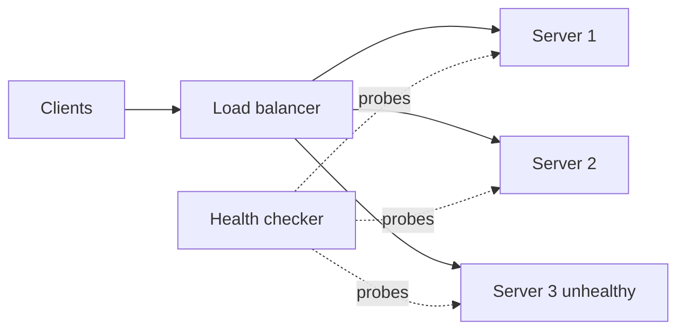
*Caption: traffic is spread across healthy servers; probes decide who is healthy.*
**Animate:** turn Server 3 red after its probes fail and reroute its share.

### Flow steps
| # | From | To | Label | Detail |
| --- | --- | --- | --- | --- |
| 1 | Client | Load balancer | Request | Arrives at a virtual IP or DNS name. |
| 2 | Load balancer | Load balancer | Pick backend | Algorithm plus health state. |
| 3 | Load balancer | Server | Forward | L7 may rewrite headers. |
| 4 | Server | Client | Response | Often via the balancer. |
| 5 | Health checker | Server | Probe | Failed probes remove it from the pool. |

### Worked example
Three equal servers, 900 QPS, probe every 5 s, unhealthy after 3 failures (15 s to detect).
One server dies: it was taking 300 QPS, so up to 300 × 15 = **4,500 requests** fail before it is removed, unless the balancer retries on another server. Weighted example: capacities 200, 200, 100 QPS give weights 2:2:1, so 500 QPS splits 200, 200, 100.

### Trade-offs and decision rules
- L4 for raw speed or non-HTTP; L7 for path and header routing.
- Least connections beats round robin when request cost varies a lot.
- Shorter probe intervals detect faster but add load and can flap.

### Common mistakes
- A single balancer with no standby.
- Sticky sessions hiding state that should live in a shared store.
- Health checks that only test "port open", not "can serve".

### Interview questions
1. **L4 vs L7?**
   - L4 is connection-level and fast; L7 understands HTTP and routes by content.
2. **How do you avoid a balancer SPOF?**
   - Redundant pair or managed multi-zone service, plus DNS or anycast in front.
3. **When use least connections?**
   - When request durations vary widely or connections are long-lived.

### Quick checks
- Which layer can route by URL path? **L7.**
- What detection time does a 5 s interval with 3 failures give? **About 15 s.**

### Related topics
Foundations 06, 23 (Reverse Proxy), 15 (API Gateway), 22 (Service Discovery)

---

## 14. API (The Waiter)

**Level:** Beginner to intermediate | **Read time:** 15 min | **Prerequisites:** Foundations 05, 09, 10 (Client & Server)

**Existing card covers:** the API as a controlled interface between clients and backend services. This spec adds REST contract and method detail. Keep the card title and extend it.

### Learning objectives
- Model resources and choose the right HTTP method and status code.
- Use conditional requests to save bandwidth.
- Design filtering, sorting and pagination that scale.
- Secure and version an API sensibly.

### Plain-language explanation
REST treats everything as a noun (a resource) with a URL, and uses a small, fixed set of verbs (HTTP methods) to act on it. Because the verbs mean the same thing everywhere, clients, caches and proxies can behave sensibly without knowing your application.

### How it works
1. **Resources**: plural nouns, nested only when ownership is real: `/users/42/orders`.
2. **Methods**: GET reads (safe and idempotent), POST creates or runs an action, PUT replaces (idempotent), PATCH changes part (not guaranteed idempotent), DELETE removes (idempotent).
3. **Status codes**: 200 OK, 201 Created, 204 No Content, 304 Not Modified, 400 Bad Request, 401 Unauthenticated, 403 Forbidden, 404 Not Found, 409 Conflict, 422 Unprocessable, 429 Too Many Requests, 500, 503.
4. **Query design**: filter and sort with parameters; paginate with a cursor for large lists.
5. **Conditional requests**: server sends `ETag`; client sends `If-None-Match`; unchanged data returns 304 with no body.
6. **Auth**: bearer tokens in `Authorization`; authorise per resource; never put secrets in URLs.
7. **Versioning and limits**: version the contract, return `429` with `Retry-After`, accept `Idempotency-Key` on POST.

### Key terms
Resource, representation, safe, idempotent, ETag, cursor, bearer token, rate limit.

### Diagrams
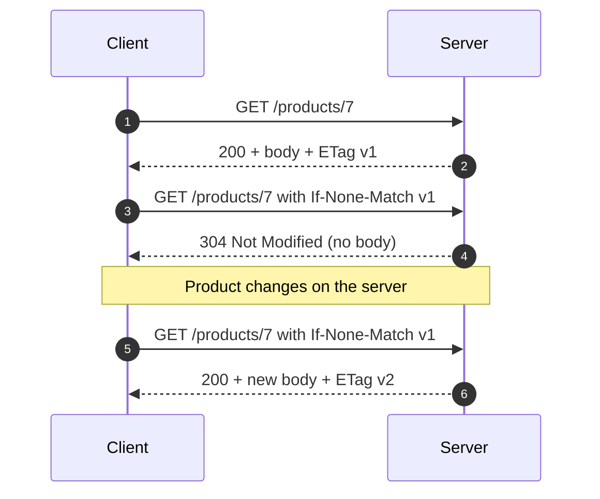
*Caption: a conditional GET returns a body only when something changed.*
**Animate:** make the response arrow thick for a body and thin for a 304.

### Flow steps
| # | From | To | Label | Detail |
| --- | --- | --- | --- | --- |
| 1 | Client | Server | GET | First fetch, no validator. |
| 2 | Server | Client | 200 + ETag | Client stores body and tag. |
| 3 | Client | Server | GET + If-None-Match | Asks "has it changed?" |
| 4 | Server | Client | 304 | No body, saves bandwidth. |
| 5 | Server | Client | 200 + new ETag | Sent only after a real change. |

### Worked example
A 200 KB resource fetched 10,000 times a minute, unchanged 90% of the time, 304 headers about 0.5 KB:
- Without ETag: 10,000 × 200 KB = 2,000 MB per minute.
- With ETag: 9,000 × 0.5 KB + 1,000 × 200 KB = 4.5 MB + 200 MB ≈ **205 MB per minute**, about 90% less.

### Trade-offs and decision rules
- REST suits public, cacheable resources. Use gRPC internally if you need streaming or tight typing.
- Prefer a stable cursor over offset on big lists.
- Return enough in errors for a client to act: code, message, request ID.

### Common mistakes
- Verbs in URLs (`/getUser`), or 200 with an error body.
- Using POST for everything, which defeats caching.
- Leaking internal IDs or fields through responses.

### Interview questions
1. **PUT vs PATCH vs POST?**
   - PUT replaces and is idempotent, PATCH modifies part, POST creates or triggers an action.
2. **401 vs 403?**
   - 401: not authenticated. 403: authenticated but not allowed.
3. **How would you make a list endpoint scale?**
   - Cursor pagination, indexed filters, page size cap, optional ETag.

### Quick checks
- Is DELETE idempotent? **Yes, repeating it leaves the same end state.**
- What does a 304 contain? **Headers only, no body.**

### Related topics
Foundations 05, 09, 15 (API Gateway), 17 (Cache)

---

## 15. API Gateway

**Level:** Intermediate | **Read time:** 15 min | **Prerequisites:** 14 (API), 13 (Load Balancer), 23 (Reverse Proxy)

**Existing card covers:** the central entry point for authentication, routing, rate limits and forwarding. Keep the card title and extend it.

### Learning objectives
- Describe the cross-cutting work an API gateway centralises.
- Explain request aggregation and the backend-for-frontend pattern.
- Spot when a gateway becomes a bottleneck or holds too much logic.

### Plain-language explanation
An API gateway is the single front door for your APIs. Instead of every service re-implementing login checks, limits and logging, the gateway does them once, then hands the request to the right service.

### How it works
1. **Routing** by path, host, method or version to the right service.
2. **AuthN and AuthZ**: validate tokens, pass identity downstream.
3. **Rate limiting and quotas** per key, user or plan.
4. **Transformation**: header changes, protocol translation (REST to gRPC), response shaping.
5. **Aggregation**: one client call fans out to several services and merges the results.
6. **Observability**: access logs, metrics, trace ID injection.
7. **Resilience**: timeouts, retries and circuit breaking at the edge.
8. **BFF**: a separate gateway per client type (web, mobile) tailored to its screens.

### Key terms
Gateway, route, token validation, quota, aggregation, BFF, edge.

### Diagrams
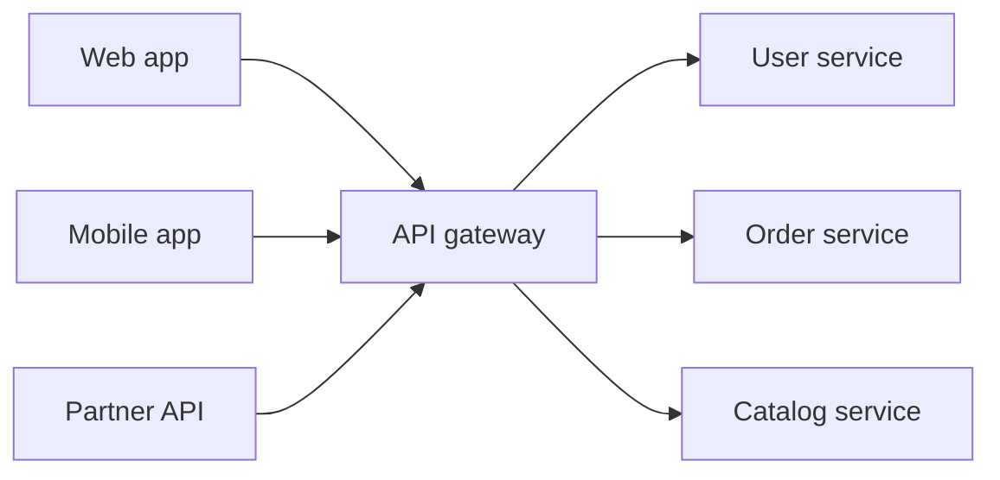
*Caption: many clients, one door, many services.*
**Animate:** a request lights up the gateway checks (auth, limit, route) before reaching a service.

### Flow steps
| # | From | To | Label | Detail |
| --- | --- | --- | --- | --- |
| 1 | Client | Gateway | Request with token | Single entry point. |
| 2 | Gateway | Gateway | Authenticate | Reject with 401 if invalid. |
| 3 | Gateway | Gateway | Rate limit | Reject with 429 if over quota. |
| 4 | Gateway | Services | Route and fan out | Calls can run in parallel. |
| 5 | Gateway | Client | Merged response | Trace ID returned for support. |

### Worked example
A mobile screen needs three backend calls of 40 ms each; client to server RTT is 100 ms.
- Client calls each service directly, in sequence: 3 × (100 + 40) = **420 ms**.
- Client calls the gateway once; it calls the three services in parallel: 100 + 40 + about 5 = **about 145 ms**.

### Trade-offs and decision rules
- Use a gateway when many clients and many services share auth, limits and logging.
- Keep business logic out of it; it should route and enforce policy.
- Run it redundantly across zones and watch its latency as a first-class metric.

### Common mistakes
- Turning the gateway into a monolith of business rules.
- Making it a single point of failure.
- Duplicating auth checks in every service without a gateway or a shared library.

### Interview questions
1. **Gateway vs load balancer?**
   - Balancer spreads traffic; gateway applies API policy (auth, limits, transformation) and routes by content.
2. **What is BFF?**
   - A gateway tailored per client type so each gets the response shape it needs.
3. **Risks of a gateway?**
   - SPOF, latency, logic creep, coupling of teams to one deploy.

### Quick checks
- Which status does an over-quota client get? **429.**
- Why aggregate at the gateway? **Fewer client round trips; parallel backend calls.**

### Related topics
14 (API), 13 (Load Balancer), 23 (Reverse Proxy), 22 (Service Discovery)

---

## 16. Database (The Library)

**Level:** Intermediate | **Read time:** 18 min | **Prerequisites:** Foundations 04

**Existing card covers:** durable storage for application data. The live summary is narrow; this spec adds ACID, SQL vs NoSQL and database types. Keep the card title and extend it.

### Learning objectives
- Explain ACID and what each letter protects.
- Compare relational, document, key-value, wide-column, graph and time-series databases.
- Choose a database from access patterns, consistency needs and scale.
- Describe polyglot persistence.

### Plain-language explanation
SQL databases are strict librarians: everything has a place, rules are enforced, and you can ask complex questions across shelves. NoSQL databases trade some of that strictness for flexibility or scale in a particular shape of problem. "NoSQL" is a family, not one thing.

### How it works
1. **ACID**: Atomicity (all or nothing), Consistency (rules hold), Isolation (concurrent transactions do not corrupt each other), Durability (committed data survives crashes).
2. **Relational**: tables, joins, SQL, strong consistency on a single node. Scales up easily; scaling out needs replication and sharding.
3. **Document**: nested records, flexible schema, good for read-as-a-unit data.
4. **Key-value**: fastest simple lookups; no rich queries.
5. **Wide-column**: huge write throughput and partitioned by key, query by key range.
6. **Graph**: relationships as first-class data; good for traversals.
7. **Time-series**: append-heavy timestamped data with rollups and retention.
8. **Consistency**: many distributed stores offer tunable or eventual consistency, trading immediacy for availability and scale.
9. **Polyglot persistence**: use more than one store, each for what it does best.

### Key terms
ACID, transaction, join, schema, eventual consistency, partition key, polyglot persistence.

### Diagrams
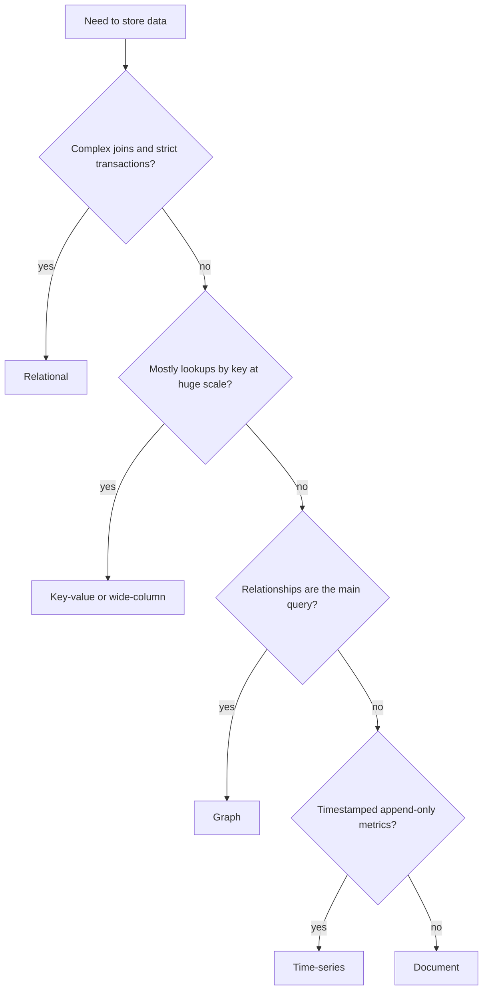
*Caption: a starting point, not a rule.*
**Animate:** step through the tree for sample workloads (bank, chat history, social graph, sensor data).

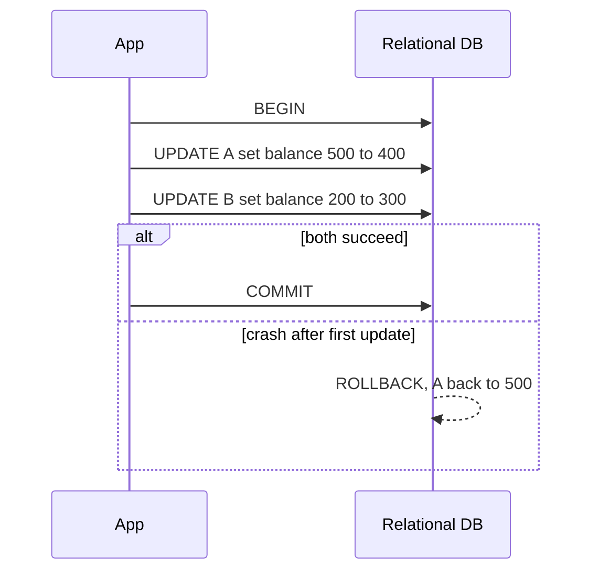
*Caption: atomicity. Either both balances change or neither does.*

### Worked example
Transfer 100 from A (500) to B (200). Inside a transaction the totals stay 700 at every committed point. Without a transaction, a crash after the first update leaves A at 400 and B at 200: 100 has vanished.

### Trade-offs and decision rules
- Default to relational unless a clear access pattern or scale need says otherwise.
- Pick a document or key-value store when the query is "get this one thing by key" at high volume.
- Every extra database adds operations, backups and consistency questions.

### Common mistakes
- Choosing NoSQL "to scale" before measuring.
- Normalising everything in a read-heavy document workload, or denormalising without a plan to update copies.
- Ignoring the consistency level the database actually gives you.

### Interview questions
1. **SQL vs NoSQL?**
   - Structure and joins and strong consistency vs flexible shape and scale in a specific pattern; depends on access patterns.
2. **What does ACID guarantee?**
   - Atomicity, consistency, isolation, durability of transactions.
3. **What is polyglot persistence?**
   - Using several stores, each matched to a workload, and managing the copies.

### Quick checks
- Which letter of ACID means "all or nothing"? **Atomicity.**
- Good fit for a social graph? **A graph database, or a relational one with careful modelling.**

### Related topics
Foundations 04, and the Indexing, Replication and Sharding specs (no cards yet)

---

## 17. Cache (Sticky Notes)

**Level:** Beginner to intermediate | **Read time:** 15 min | **Prerequisites:** Foundations 02, 03

**Existing card covers:** cache hits and misses reducing latency and database load. Keep the card title and extend it.

### Learning objectives
- Locate the cache layers between a user and a database.
- Compare cache-aside, read-through, write-through, write-back and write-around.
- Choose an eviction policy and a TTL.
- Calculate the effect of hit ratio on latency and database load.

### Plain-language explanation
A cache keeps a copy of expensive-to-get data somewhere closer and faster. The price is that the copy can be out of date, so every cache is a bet that being fast is worth occasionally being slightly stale.

### How it works
1. **Layers**: browser, CDN, reverse proxy, application memory, distributed cache (Redis), database buffer pool.
2. **Cache-aside**: app checks cache, loads from the database on a miss, then fills the cache. The most common pattern.
3. **Read-through**: the cache itself loads on a miss.
4. **Write-through**: write to cache and database together; consistent, slower writes.
5. **Write-back**: write to cache, flush to the database later; fast, risk of loss on a crash.
6. **Write-around**: write to the database only; the cache fills on later reads.
7. **Eviction**: LRU (least recently used), LFU (least frequently used), TTL expiry.
8. **Failure modes**: stampede (many misses at once), penetration (requests for keys that never exist), stale data.

### Key terms
Hit, miss, hit ratio, TTL, eviction, stampede, cache-aside, write-through, write-back.

### Diagrams
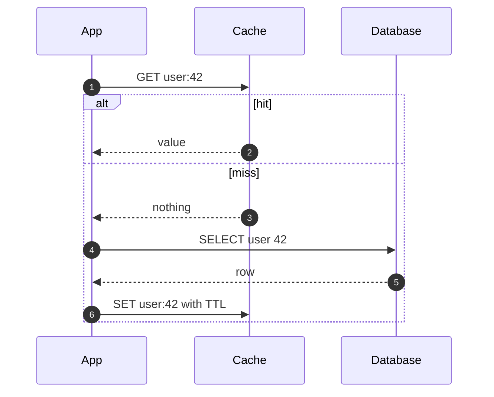
*Caption: cache-aside.*
**Animate:** toggle hit and miss; show the miss path adding the database hop.

### Flow steps
| # | From | To | Label | Detail |
| --- | --- | --- | --- | --- |
| 1 | App | Cache | Read key | First stop for every read. |
| 2 | Cache | App | Hit | Done; fastest path. |
| 3 | App | Database | Read on miss | Slow path. |
| 4 | App | Cache | Fill with TTL | Next reader gets a hit. |

### Worked example
Cache read 1 ms, database read 20 ms, a miss costs 1 + 20 = 21 ms, load 1,000 QPS.
- 90% hits: 0.9 × 1 + 0.1 × 21 = **3.0 ms**; database sees **100 QPS**.
- 99% hits: 0.99 × 1 + 0.01 × 21 = **1.2 ms**; database sees **10 QPS**.
Going from 90% to 99% cut database load tenfold.

### Trade-offs and decision rules
- Cache data that is read often, changes rarely and is costly to compute.
- Pick TTLs from how stale the business can tolerate, not from convenience.
- Protect against stampede with request coalescing, jittered TTLs or early refresh.

### Common mistakes
- Caching without a plan to invalidate.
- No TTL, so stale data lives forever.
- Treating the cache as the source of truth.

### Interview questions
1. **Cache-aside vs write-through?**
   - Aside: app manages the cache, lazy fill. Write-through: every write updates both, stronger consistency, slower writes.
2. **What is a cache stampede and how do you stop it?**
   - Many simultaneous misses overload the database; use locking per key, jitter, stale-while-revalidate.
3. **LRU vs LFU?**
   - LRU favours recency; LFU favours popularity; LFU resists one-off scans.

### Quick checks
- If hit ratio rises from 90% to 95%, what happens to database load? **It halves.**
- Which pattern risks data loss on a cache crash? **Write-back.**

### Related topics
Foundations 02, 03, 23 (Reverse Proxy), 18 (Redis), 21 (CDN)

---

## 18. Redis

**Level:** Intermediate | **Read time:** 18 min | **Prerequisites:** 17 (Cache)

**Existing card covers:** Redis as fast in-memory storage for common application data. Keep the card title and extend it.

For interview-style questions, link this lesson to the existing `/roadmaps/redis` guide rather than repeating it.

### Learning objectives
- Choose the right Redis data structure for a problem.
- Explain how Redis persists and replicates data and what can be lost.
- Describe Redis Cluster slots and how keys map to nodes.
- Use Redis safely for caching, counters, leaderboards and locks.

### Plain-language explanation
Redis is a very fast in-memory data structure server. It is not just a key-value cache: it offers lists, sets, sorted sets and more, so you can solve problems like leaderboards and counters with a single command.

### How it works
1. **Structures**: strings, hashes, lists, sets, sorted sets, streams, bitmaps, HyperLogLog.
2. **Execution**: commands run one at a time on a single main thread, so each command is atomic. Optional I/O threads help with networking.
3. **Persistence**: RDB snapshots (compact, can lose recent writes) and AOF append-only log (more durable, larger). Many deployments use both or neither for pure caches.
4. **Replication**: asynchronous primary to replicas; a failover can lose writes not yet replicated.
5. **High availability**: Sentinel monitors and promotes a replica.
6. **Cluster**: 16,384 hash slots split across primaries; slot = `CRC16(key) mod 16384`.
7. **Eviction**: with a memory limit, policies such as `allkeys-lru` or `volatile-ttl`; `noeviction` returns errors instead.
8. **Patterns**: cache (`SET` with `EX`), counters and rate limits (`INCR` plus `EXPIRE`), leaderboards (`ZADD`, `ZREVRANGE`), locks (`SET key value NX PX`), queues and streams.

### Key terms
Slot, RDB, AOF, Sentinel, eviction policy, pipeline, TTL, atomic.

### Diagrams
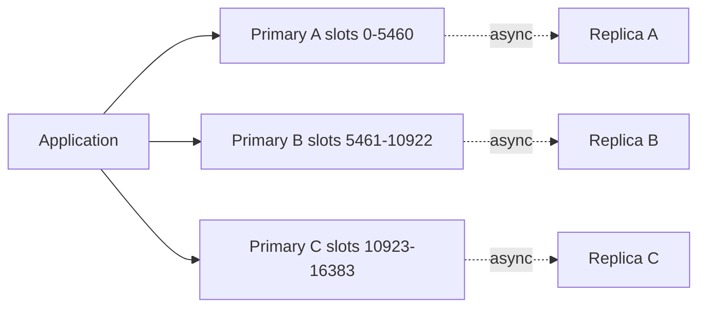
*Caption: a three-primary Redis Cluster with one replica each.*
**Animate:** hash a key to a slot and light the owning primary; "fail" a primary and promote its replica.

### Worked example
- **Sizing (assumption):** 10 M keys × (20 B key + 100 B value + about 100 B overhead) ≈ **2.2 GB**. Measure real overhead before provisioning.
- **Leaderboard:** `ZADD board 1500 alice` then `ZREVRANGE board 0 9 WITHSCORES` returns the top 10 in O(log N + 10).
- **Replication risk:** at 5,000 writes/s with 100 ms replica lag, a failover can lose up to about **500 writes**.

### Trade-offs and decision rules
- Use Redis for hot, small, structured data; keep the source of truth elsewhere.
- Choose persistence by how costly it is to rebuild the data.
- Avoid big keys and commands that scan everything (`KEYS`); use `SCAN`.

### Common mistakes
- Assuming Redis never loses data.
- Unbounded growth with no TTL or eviction policy.
- Locks without an expiry or a safe release.

### Interview questions
1. **Why is Redis fast?**
   - In-memory, simple data structures, single-threaded command execution without lock contention, pipelining.
2. **RDB vs AOF?**
   - Snapshot vs log; compactness vs durability.
3. **How does Cluster route a key?**
   - CRC16 of the key modulo 16,384 picks a slot owned by one primary; clients follow redirects.

### Quick checks
- How many slots does Redis Cluster have? **16,384.**
- Is a single Redis command atomic? **Yes.**

### Related topics
17 (Cache), 19 (Message Queue), `/roadmaps/redis`, Consistent Hashing, and the Sharding spec (no card yet)

---

## 19. Message Queue (The Waiting Line)

**Level:** Intermediate | **Read time:** 15 min | **Prerequisites:** Foundations 02, 06

**Existing card covers:** queues letting workers process asynchronous work after the request returns. Keep the card title and extend it.

### Learning objectives
- Explain why a queue decouples producers from consumers.
- Compare at-most-once, at-least-once and effectively-once processing.
- Describe acknowledgements, visibility timeouts and dead-letter queues.
- Size consumers with Little's Law and spot a growing backlog.

### Plain-language explanation
A queue is a line at a counter. The sender drops a task in the line and moves on; workers take tasks when ready. If workers are slow or down for a while, the line grows but nothing is lost, and the sender is never blocked.

### How it works
1. **Roles**: producers publish messages, the queue stores them, consumers process and acknowledge them.
2. **Work queue**: each message goes to one consumer. **Pub/sub**: each message goes to every subscriber.
3. **Delivery semantics**: at-most-once (may lose), at-least-once (may duplicate; the common default), effectively-once (at-least-once plus idempotent consumers).
4. **Ack and redelivery**: a message is hidden while a consumer works on it (visibility timeout); no ack before the timeout means it returns to the queue.
5. **Dead-letter queue (DLQ)**: messages that fail repeatedly go aside for inspection.
6. **Ordering**: usually per queue or per key, not global at scale.
7. **Backpressure**: when consumers cannot keep up, the backlog grows; limit, scale out or shed load.
8. **Typical uses**: emails, image processing, order pipelines, smoothing traffic spikes.

### Key terms
Producer, consumer, broker, ack, visibility timeout, DLQ, idempotency, backlog, backpressure.

### Diagrams
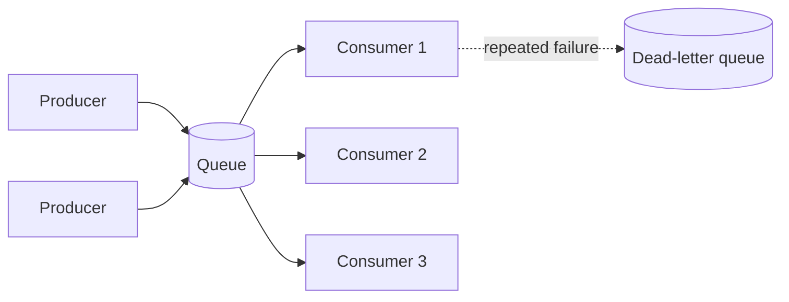
*Caption: producers and consumers never talk to each other directly.*
**Animate:** messages pile up when consumers pause, then drain when they resume.

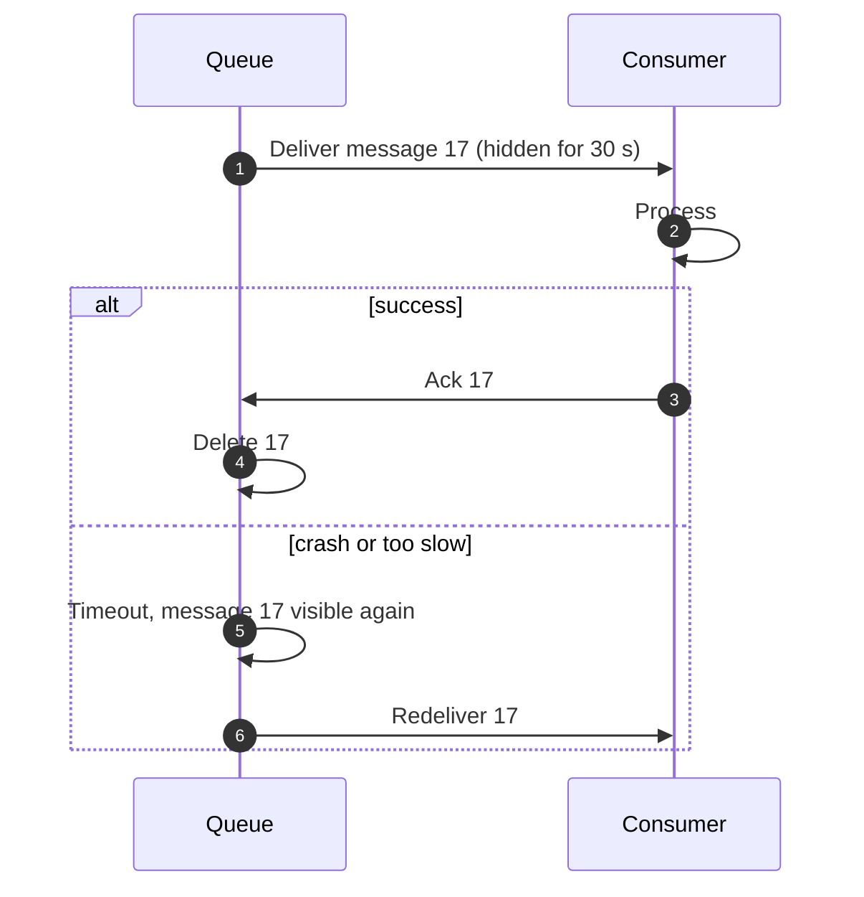
*Caption: redelivery is why consumers must be idempotent.*

### Flow steps
| # | From | To | Label | Detail |
| --- | --- | --- | --- | --- |
| 1 | Producer | Queue | Publish | Producer returns immediately. |
| 2 | Queue | Consumer | Deliver | Message becomes invisible. |
| 3 | Consumer | Consumer | Process | Must finish before the timeout. |
| 4 | Consumer | Queue | Ack | Message is deleted. |
| 5 | Queue | Consumer | Redeliver | Only if there was no ack. |

### Worked example
Arrival 1,000 msg/s, each message takes 50 ms. By Little's Law: 1,000 × 0.05 = **50 concurrent workers** busy; at a 70% utilisation target, about **72** workers.
If total capacity is only 800 msg/s, the backlog grows by 200/s = **12,000 per minute** until something changes.

### Trade-offs and decision rules
- Use a queue when the work can finish later and the caller does not need the result now.
- Make consumers idempotent and set the visibility timeout above the real processing time.
- Alert on queue depth and oldest-message age, not only on errors.

### Common mistakes
- Assuming exactly-once delivery.
- No DLQ, so one poison message blocks or loops forever.
- Visibility timeout shorter than processing time, causing duplicates.

### Interview questions
1. **Why use a queue?**
   - Decoupling, smoothing spikes, retries, independent scaling.
2. **At-least-once vs exactly-once?**
   - Real systems deliver at-least-once; effect is made exactly-once with idempotent handlers.
3. **What is a DLQ for?**
   - Isolating messages that repeatedly fail so they can be inspected and replayed.

### Quick checks
- What happens when a consumer crashes mid-task? **The message becomes visible again and is redelivered.**
- Which metric warns of a lagging consumer fleet? **Queue depth or oldest-message age.**

### Related topics
Foundations 02, 18 (Redis), 20 (Kafka)

---

## 20. Kafka

**Level:** Intermediate to advanced | **Read time:** 20 min | **Prerequisites:** 19 (Message Queue)

**Existing card covers:** producers publishing events that independent consumers read. Keep the card title and extend it.

Answers target the Kafka 4.x KRaft architecture and conventional consumer groups. Link to the existing `/roadmaps/kafka` guide for interview questions instead of repeating them.

### Learning objectives
- Explain Kafka as a partitioned, replicated, append-only log.
- Describe consumer groups, offsets and how ordering works.
- Configure producers and topics for durability.
- Size partitions from throughput targets.

### Plain-language explanation
Kafka is a durable, replayable logbook. Producers append events to the end; consumers read from any position and remember where they stopped. Unlike a simple queue, events are not removed when read, so many different consumers can read the same history independently.

### How it works
1. **Topics and partitions**: a topic is split into partitions; each partition is an ordered log with increasing offsets.
2. **Ordering** is guaranteed only within a partition. The message key chooses the partition, so events with the same key stay in order.
3. **Brokers and replication**: each partition has a leader and followers; the in-sync replicas (ISR) are those caught up.
4. **Producer durability**: `acks=all` waits for the ISR; with replication factor 3 and `min.insync.replicas=2`, one broker can fail without losing acknowledged data or blocking writes.
5. **Idempotent producer and transactions** prevent duplicates and allow atomic multi-partition writes.
6. **Consumer groups**: partitions are divided among the group's consumers; each partition has one consumer in the group, so useful parallelism is at most the partition count.
7. **Offsets and lag**: committed offsets record progress; lag = latest offset minus committed offset.
8. **Retention and compaction**: keep by time or size, or keep the latest value per key.
9. **KRaft**: Kafka 4.x manages cluster metadata itself with a Raft-based controller quorum, no ZooKeeper.

### Key terms
Topic, partition, offset, broker, leader, ISR, consumer group, lag, retention, compaction, KRaft.

### Diagrams
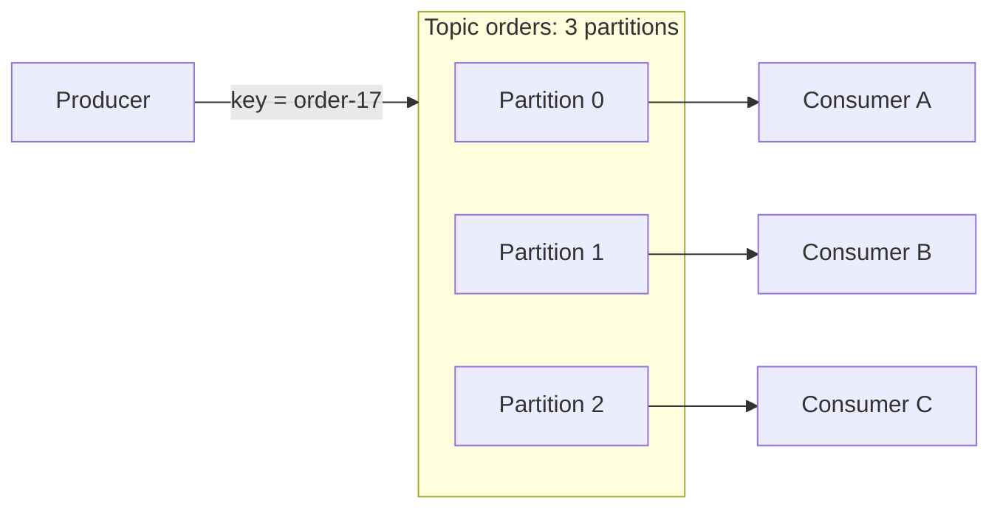
*Caption: one group of three consumers reads three partitions in parallel.*
**Animate:** hash a key to a partition; add a fourth consumer and show it idle.

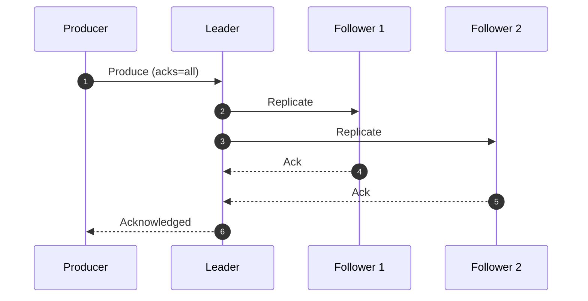
*Caption: acks=all waits for the in-sync replicas.*

### Flow steps
| # | From | To | Label | Detail |
| --- | --- | --- | --- | --- |
| 1 | Producer | Leader | Produce | Key picks the partition. |
| 2 | Leader | Followers | Replicate | Followers append to their logs. |
| 3 | Followers | Leader | Ack | Counts toward the ISR. |
| 4 | Leader | Producer | Acknowledged | Safe to treat as durable. |
| 5 | Consumer | Leader | Fetch from offset | Reads without deleting. |
| 6 | Consumer | Kafka | Commit offset | Records progress. |

### Worked example
Target 100 MB/s. Assumed per-partition limits: producer 10 MB/s, consumer 5 MB/s.
Partitions needed = max(100 ÷ 10, 100 ÷ 5) = max(10, 20) = **20**. The slower consumer side decides. More partitions allow more parallel consumers but add overhead and make later changes harder, so add headroom, not extremes.

### Trade-offs and decision rules
- Kafka for high-throughput event streams, replay and multiple independent consumers; a simple queue for basic task distribution.
- Pick keys for the ordering you need and an even spread.
- Treat the partition count as hard to reduce; plan it.

### Common mistakes
- Expecting global ordering across partitions.
- More consumers than partitions.
- `acks=1` for data that cannot be lost.

### Interview questions
1. **How does Kafka guarantee ordering?**
   - Per partition only; use a key to keep related events together.
2. **How do you avoid data loss?**
   - Replication factor 3, `acks=all`, `min.insync.replicas=2`, idempotent producer.
3. **What is consumer lag and why watch it?**
   - Distance behind the log end; rising lag means consumers cannot keep up.

### Quick checks
- Max useful consumers in a group with 12 partitions? **12.**
- Does reading a message remove it? **No; retention removes it.**

### Related topics
18 (Redis), 19 (Message Queue), `/roadmaps/kafka`

---

## 21. CDN (Delivery Warehouse)

**Level:** Beginner to intermediate | **Read time:** 15 min | **Prerequisites:** 09, 23 (Reverse Proxy), 17 (Cache)

**Existing card covers:** serving nearby copies of static content to reduce latency. Keep the card title and extend it.

### Learning objectives
- Explain how a CDN puts content near users.
- Control caching with `Cache-Control`, cache keys and versioned filenames.
- Describe origin shield and invalidation.
- Estimate origin load and latency savings.

### Plain-language explanation
A CDN is a network of small warehouses around the world. The first person near a warehouse to ask for an item makes the warehouse fetch it from the factory (your origin). Everyone nearby afterwards is served from the warehouse, much closer and much faster.

### How it works
1. **Edge locations (PoPs)** hold cached copies; users are routed to a nearby one by DNS or anycast.
2. **Pull model**: the edge fetches from the origin on a miss. **Push model**: you upload content ahead of time.
3. **Cache key**: usually URL plus selected headers or query parameters. Too many variations lower the hit ratio.
4. **Cache-Control**: `max-age`, `s-maxage`, `public`, `private`, `no-store`, `stale-while-revalidate`.
5. **Versioned filenames** (`app.3f9c2a.js`) let you cache for a year and update instantly by changing the name.
6. **Origin shield**: a middle cache layer so many edges share one miss to the origin.
7. **Invalidation (purge)** removes content before expiry; slower and costlier than versioning.
8. **Extras**: TLS at the edge, DDoS absorption, image optimisation, dynamic acceleration over warm connections.

### Key terms
Edge, PoP, origin, cache key, TTL, hit ratio, purge, anycast, origin shield.

### Diagrams
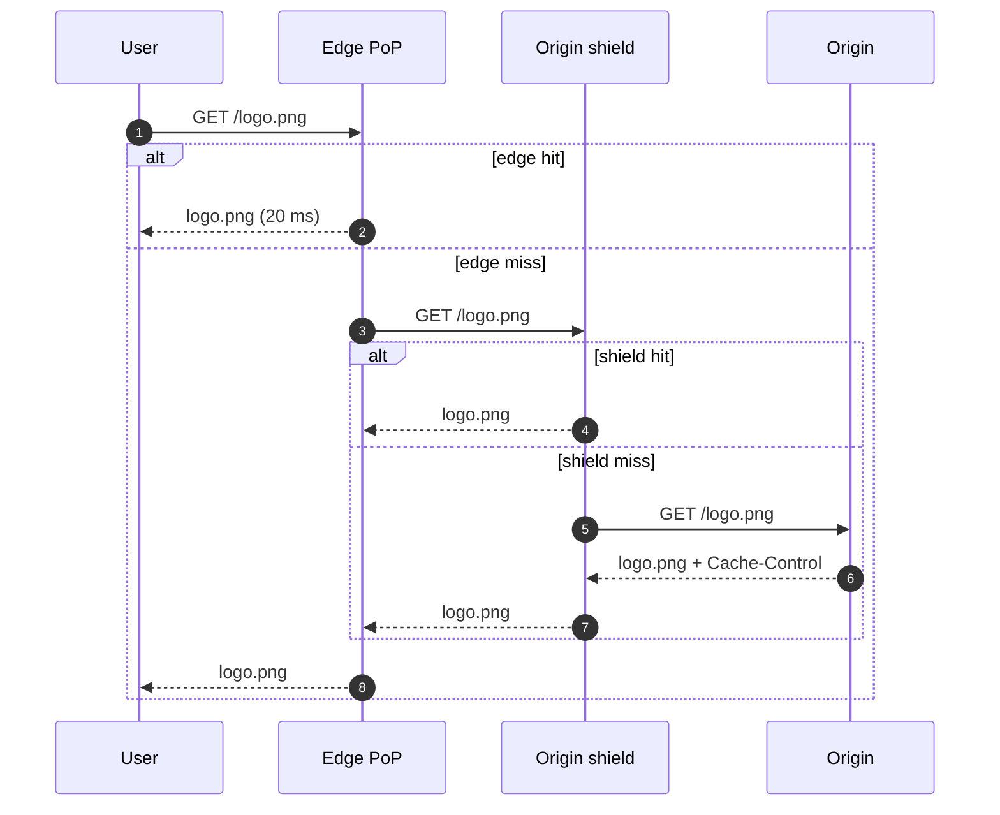
*Caption: three tiers of cache, one trip to the origin at most.*
**Animate:** replay as first user (miss), second user (edge hit), user in another region (shield hit).

### Flow steps
| # | From | To | Label | Detail |
| --- | --- | --- | --- | --- |
| 1 | User | Edge | Request | Routed to the nearest PoP. |
| 2 | Edge | User | Hit | Served from local cache. |
| 3 | Edge | Shield | Miss | Asks the shared layer. |
| 4 | Shield | Origin | Miss | Only now does the origin work. |
| 5 | Origin | Edge | Response | Cached by TTL on the way back. |

### Worked example
10,000 requests/s with a 95% hit ratio: the origin sees 10,000 × 0.05 = **500 requests/s**.
Latency: RTT to the edge 20 ms vs to the origin 150 ms. TCP + TLS 1.3 setup is 2 RTT: **40 ms** at the edge vs **300 ms** at the origin.

### Trade-offs and decision rules
- Cache static assets aggressively with versioned names; keep HTML TTL short.
- Do not cache personalised responses without a safe cache key.
- Prefer new filenames over purging.

### Common mistakes
- Cookies or query strings in the cache key that fragment the cache.
- Caching error responses for too long.
- Forgetting to protect the origin from direct access.

### Interview questions
1. **How does a CDN reduce latency and load?**
   - Shorter network path, cached responses, fewer origin requests.
2. **Invalidate or version?**
   - Version filenames for assets; purge for emergencies and non-versioned content.
3. **What is an origin shield?**
   - An intermediate cache that collapses misses from many edges.

### Quick checks
- What does a 95% hit ratio do to origin load? **Cuts it to 5%.**
- Which header controls edge-specific TTL? **`s-maxage`.**

### Related topics
09, 23 (Reverse Proxy), 17 (Cache), the Object Storage spec (no card yet)

---

## 22. Service Discovery

**Level:** Intermediate | **Read time:** 15 min | **Prerequisites:** 13 (Load Balancer), 15 (API Gateway)

**Existing card covers:** services finding current healthy instances through a registry. Keep the card title and extend it.

### Learning objectives
- Explain why fixed addresses fail in dynamic environments.
- Compare client-side and server-side discovery.
- Describe registration, health checking and TTL.
- Explain how Kubernetes Services provide discovery.

### Plain-language explanation
In a modern system, servers start, stop and move constantly, so their addresses keep changing. Service discovery is a live phone book: services announce themselves when they start, are removed when they die, and callers ask the phone book instead of using a hard-coded address.

### How it works
1. **Registry**: a store of service names to healthy instance addresses (Consul, etcd, Eureka, or the Kubernetes API).
2. **Registration**: self-registration (the instance announces itself) or third-party (a platform registers it).
3. **Liveness**: heartbeats with a TTL, or active health checks; an instance that stops reporting is removed.
4. **Client-side discovery**: the caller queries the registry and picks an instance itself (needs a smart client).
5. **Server-side discovery**: the caller hits a stable address (balancer, proxy) that consults the registry.
6. **DNS-based**: names resolve to current instances; simple, but TTLs and client caching delay updates.
7. **Kubernetes**: a Service gives a stable virtual IP and DNS name such as `orders.shop.svc.cluster.local`; endpoints follow pods that pass readiness checks.

### Key terms
Registry, registration, heartbeat, TTL, health check, endpoint, client-side, server-side.

### Diagrams
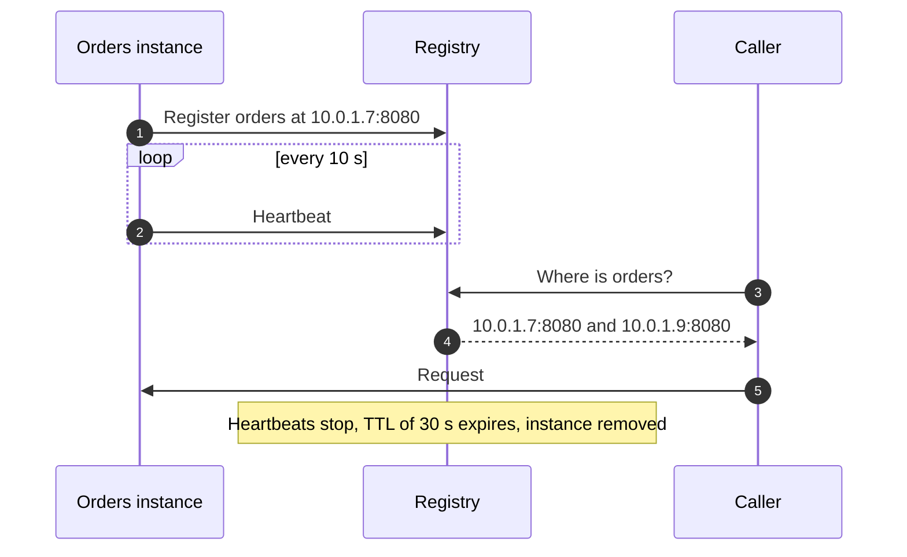
*Caption: register, heartbeat, look up, and expire.*
**Animate:** stop the heartbeat arrows and show the entry fading after the TTL.

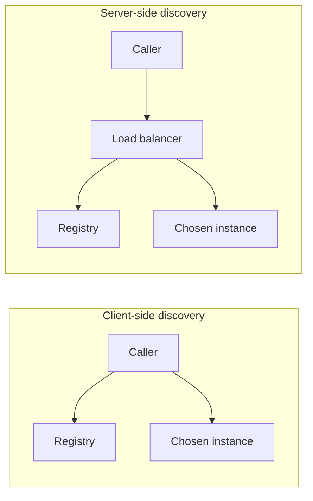
*Caption: who does the lookup, the caller or a balancer.*

### Flow steps
| # | From | To | Label | Detail |
| --- | --- | --- | --- | --- |
| 1 | Instance | Registry | Register | Name, address and metadata. |
| 2 | Instance | Registry | Heartbeat | Repeats until shutdown. |
| 3 | Caller | Registry | Lookup | Returns current healthy instances. |
| 4 | Caller | Instance | Request | Retries on another instance on failure. |
| 5 | Registry | Registry | Expire | Missing heartbeats remove the entry. |

### Worked example
Heartbeat every 10 s, TTL 30 s. A crashed instance can stay listed for up to **30 s**. If it was receiving 100 requests/s, up to **3,000 requests** may be sent to a dead address unless callers retry on another instance or health checks remove it sooner.

### Trade-offs and decision rules
- Prefer the platform's built-in discovery (Kubernetes Services) when you have one.
- Shorter TTLs remove dead instances faster but increase registry load and false removals.
- Callers still need timeouts and retries; discovery narrows the window, it does not close it.

### Common mistakes
- Caching lookup results for too long.
- Registering an instance before it is ready.
- Making the registry a single point of failure.

### Interview questions
1. **Client-side vs server-side discovery?**
   - Client-side: caller queries the registry and balances. Server-side: a fronting component does it.
2. **How does the registry notice a dead instance?**
   - Missed heartbeats beyond a TTL or failed health checks.
3. **How does Kubernetes do discovery?**
   - Services, endpoints driven by readiness, and cluster DNS.

### Quick checks
- What does a stale registry entry cause? **Requests to a dead instance.**
- What stable thing does a Kubernetes Service provide? **A virtual IP and a DNS name.**

### Related topics
13 (Load Balancer), 15 (API Gateway), Foundations 08

---

## 23. Reverse Proxy

**Level:** Beginner to intermediate | **Read time:** 12 min | **Prerequisites:** 09, 13 (Load Balancer)

**Existing card covers:** fronting backend servers, receiving requests and forwarding them. Keep the card title and extend it.

### Learning objectives
- Contrast forward and reverse proxies.
- List the jobs a reverse proxy does for a backend.
- Explain how buffering protects application workers from slow clients.
- Separate reverse proxy, load balancer and API gateway.

### Plain-language explanation
A reverse proxy stands in front of your servers and speaks to the world on their behalf. Clients never see the real servers. The proxy can tidy the request, answer from memory, compress the reply and shield the servers from slow or hostile callers.

### How it works
1. **Forward proxy** acts for clients (outbound). **Reverse proxy** acts for servers (inbound).
2. **Jobs**: TLS termination, routing by host or path, caching static or cacheable responses, compression, request and response buffering, connection reuse, basic rate limiting, hiding origin addresses, optional WAF rules.
3. **Buffering**: the proxy takes the full response from the app quickly, then feeds a slow client at its own pace, freeing the app worker.
4. **Relationship to others**: a load balancer's focus is distribution; a reverse proxy's focus is request handling; an API gateway adds API-specific policy. In practice one product (Nginx, HAProxy, Envoy) can play several roles.

### Key terms
Forward proxy, reverse proxy, origin, TLS termination, buffering, compression, WAF.

### Diagrams
```mermaid
flowchart LR
    C[Client] --> RP[Reverse proxy]
    RP -->|"/static"| ST[Static files or cache]
    RP -->|"/api"| APP[App servers]
    RP -->|"/admin"| ADM[Admin service]
```
*Caption: one public entry, several private back ends.*
**Animate:** colour each path as the proxy picks a route.

### Flow steps
| # | From | To | Label | Detail |
| --- | --- | --- | --- | --- |
| 1 | Client | Reverse proxy | HTTPS request | TLS ends here. |
| 2 | Reverse proxy | Reverse proxy | Cache lookup | A hit returns immediately. |
| 3 | Reverse proxy | App server | Forward on miss | Plain HTTP on a private network. |
| 4 | App server | Reverse proxy | Response | Buffered in full. |
| 5 | Reverse proxy | Client | Compressed response | Fed at the client's speed. |

### Worked example
App generates a reply in 20 ms; a slow mobile client takes 2 s to receive it. At 500 requests per second, Little's Law (L = λ × W):
- Without buffering the worker is held 2.02 s: 500 × 2.02 ≈ **1,010 workers**.
- With buffering the worker is held 0.02 s: 500 × 0.02 = **10 workers**.
Compression bonus: a 100 KB JSON body that gzips about 80% smaller (assumption) saves 80 KB × 1,000 QPS = 80 MB/s.

### Trade-offs and decision rules
- One more hop adds a little latency but removes a lot of load from the app tier.
- Cache only responses that are safe to share between users.
- Keep proxy config in version control and test it like code.

### Common mistakes
- Caching personalised responses and leaking them between users.
- Forgetting `X-Forwarded-For`, so the app logs the proxy IP.
- Treating the proxy as a security boundary without a WAF or limits.

### Interview questions
1. **Forward vs reverse proxy?**
   - Forward fronts clients; reverse fronts servers and hides them.
2. **Why put Nginx in front of an app server?**
   - TLS, static files, buffering slow clients, compression, routing.
3. **Reverse proxy vs load balancer?**
   - Overlapping; proxy handles request processing, balancer distributes traffic.

### Quick checks
- What does buffering protect? **Application workers from slow clients.**
- Which header preserves the client IP? **`X-Forwarded-For` (or the standard `Forwarded`).**

### Related topics
09, 13 (Load Balancer), 15 (API Gateway), 17 (Cache), 21 (CDN)

---

## 24. Putting Everything Together

**Level:** Intermediate | **Read time:** 20 min | **Prerequisites:** 09-23 (this is the capstone; implement it last)

**Existing card covers:** combines DNS, CDN, load balancing, gateway, app, Redis, database and Kafka into one request path. Keep the card title and extend it.

### Learning objectives
- Trace one request through every building block in order.
- Say which problem each block solves and what happens if it fails.
- Estimate end-to-end latency and availability for the whole path.
- Explain why some work happens in the request and some after it.

### Plain-language explanation
Each earlier lesson was one tool. This lesson uses them all in one story: a shopper opens a shop's page and places an order. Some steps must finish before the shopper sees "order placed". Others (payment processing, emails) can safely happen a moment later.

### How it works
Scenario: a user opens a shopping app and places an order.
1. **DNS** (11) turns the shop's name into the address of the nearest entry point.
2. **CDN** (21) serves the page shell, scripts and images from a nearby cache.
3. **Load balancer** (13) spreads the order request across healthy entry nodes; a **reverse proxy** (23) terminates TLS and forwards it.
4. **API gateway** (15) verifies the token, applies rate limits and routes the call.
5. **Service discovery** (22) tells the gateway which Orders instances are healthy.
6. **Orders service** reads product prices from **Redis** (18), the cache (17), falling back to the **database** (16) on a miss.
7. Orders **writes the order** to the database in one transaction.
8. Orders **publishes an `OrderPlaced` event** to **Kafka** (20) and returns `201 Created`.
9. **After the response**: payment, inventory, analytics and email consumers read the event; email work goes through a **message queue** (19).

### Key terms
Request path, synchronous work, asynchronous work, event, fan-out, single point of failure, latency budget.

### Diagrams
```mermaid
sequenceDiagram
    autonumber
    participant U as User
    participant CDN as CDN
    participant LB as Load balancer
    participant GW as API gateway
    participant ORD as Orders service
    participant RD as Redis
    participant DB as Database
    participant KF as Kafka
    U->>CDN: Load page assets
    CDN-->>U: Cached shell, scripts, images
    U->>LB: POST /orders over HTTPS
    LB->>GW: Forward to a healthy node
    GW->>GW: Verify token, rate limit
    GW->>ORD: Route (instance from service discovery)
    ORD->>RD: Get product prices
    RD-->>ORD: Prices (cache hit)
    ORD->>DB: INSERT order
    DB-->>ORD: Committed
    ORD->>KF: Publish OrderPlaced
    KF-->>ORD: Acknowledged
    ORD-->>U: 201 Created
```
*Caption: the synchronous path the user waits for.*
**Animate:** a signal travels the path with a running millisecond counter; click a component to "fail" it and see the effect.

```mermaid
flowchart LR
    K[(Kafka topic orders)] --> PAY[Payment service]
    K --> INV[Inventory service]
    K --> AN[Analytics consumer]
    K --> EQ[(Email queue)]
    EQ --> EW[Email workers]
```
*Caption: after the response, consumers react to the event independently.*

### Flow steps
| # | From | To | Label | Detail |
| --- | --- | --- | --- | --- |
| 1 | User | CDN | Page assets | Cache hit; no origin work. |
| 2 | User | Load balancer | POST /orders | TLS ends at the edge tier. |
| 3 | Load balancer | API gateway | Forward | Only healthy nodes. |
| 4 | API gateway | API gateway | Auth and limits | 401 or 429 stops it here. |
| 5 | API gateway | Orders service | Route | Instance found via discovery. |
| 6 | Orders service | Redis | Price lookup | Miss falls back to the database. |
| 7 | Orders service | Database | Write order | Transaction commits. |
| 8 | Orders service | Kafka | Publish event | Acknowledged before replying. |
| 9 | Orders service | User | 201 Created | User sees success. |
| 10 | Kafka | Consumers | Fan out event | Payment, inventory, email, analytics. |

### Worked example
Illustrative latency for a cold connection, user-to-region RTT 60 ms:
- Connection setup (TCP + TLS 1.3): 2 × 60 = **120 ms**.
- Request and response: **60 ms**.
- Server work: balancer 1 + gateway 5 + Orders logic 10 + Redis 1 + database write 15 + Kafka publish 10 = **42 ms**.
- Total: 120 + 60 + 42 = **222 ms** cold, or 60 + 42 = **102 ms** on a reused connection.
Payment, inventory and email add **0 ms** to the user's wait because they run after the reply.

Availability in series, assuming gateway 99.99%, Orders 99.9% and database 99.95%:
0.9999 × 0.999 × 0.9995 ≈ 0.9984, so about **99.84%**, lower than any single part.

### What breaks and what degrades
| If this fails | What happens |
| --- | --- |
| CDN | Assets come from the origin; origin load and latency rise. |
| Redis | Orders reads prices from the database; load rises and latency worsens. |
| One Orders instance | Discovery and health checks remove it; others take the traffic. |
| Database primary | Orders cannot be written until failover; this is a hard dependency. |
| Kafka | The order may be saved but the event not published; use the outbox pattern (store the event in the same database transaction and publish it afterwards, covered in a later lesson). |
| A consumer | Events wait in Kafka; it catches up when it returns. |

### Trade-offs and decision rules
- Each block adds latency, cost and operations. Add a block only when the problem it solves is real.
- Keep the user-visible path short; push anything that can wait behind an event or queue.
- Identify the hard dependencies (here the database) and give them the most redundancy.

### Common mistakes
- Calling payment, email and inventory synchronously inside the request.
- Treating the cache as required for correctness.
- Counting component availability in isolation instead of in series.

### Interview questions
1. **Walk through what happens when a user places an order in this system.**
   - DNS, CDN, balancer, proxy, gateway, discovery, cache, database, event, response, async consumers.
2. **Which parts are single points of failure and how do you fix them?**
   - Database primary, gateway and balancer unless redundant; add replicas, multiple zones, failover.
3. **Why publish an event instead of calling downstream services directly?**
   - Faster response, independent failure and scaling, and consumers can be added without changing Orders.

### Quick checks
- Which steps does the user wait for? **Everything up to the `201 Created`.**
- Why is the overall availability lower than each part? **Dependencies in series multiply.**

### Related topics
Foundations 02, 06, 07, 09-23

---

## Unplaced sections (no live card yet)

The four sections below were written for topics that have no card on the live page. They are complete specs, kept for when the author decides where these lessons go. Do not implement them yet.

## Unplaced A. Database Indexing

**Level:** Intermediate | **Read time:** 15 min | **Prerequisites:** 16 (Database)

**No live card yet.** Do not implement this lesson until the author decides where it goes. It must not take card number 25 or above.

### Learning objectives
- Explain how a B-tree index finds rows without scanning the table.
- Design a composite index using the leftmost-prefix rule.
- Recognise queries that cannot use an index.
- Weigh read speed against write and storage cost.

### Plain-language explanation
An index is the index at the back of a book: a sorted list that tells you which page to open instead of reading every page. It makes lookups fast and makes every change to the book slightly slower, because the index must be updated too.

### How it works
1. **Full scan**: with no useful index, the database reads every page of the table.
2. **B-tree**: a balanced, sorted tree with high fanout (hundreds of keys per node), so even huge tables are only a few levels deep. Supports equality, ranges and ordering.
3. **Hash index**: equality only, no ranges or ordering.
4. **LSM-tree engines** buffer writes in memory and merge sorted files; strong for write-heavy stores.
5. **Composite index** `(a, b, c)` serves queries on `a`, `a,b` and `a,b,c` (leftmost prefix), not on `b` alone.
6. **Covering index** contains every column the query needs, so the table is never read.
7. **Selectivity**: an index helps when it narrows to a small fraction of rows.
8. **Write cost**: every insert, update or delete also changes each index on the table.
9. **Index-defeating patterns**: a function on the column (`LOWER(email) = ...`), a leading wildcard (`LIKE '%abc'`), implicit type conversion, and low-selectivity columns.
10. **EXPLAIN** shows whether the plan uses the index and how many rows it expects.

### Key terms
B-tree, fanout, leaf, composite index, covering index, selectivity, cardinality, query plan.

### Diagrams
```mermaid
flowchart TD
    R["Root: keys 1000, 2000"] --> I1["Internal: 1-999"]
    R --> I2["Internal: 1000-1999"]
    R --> I3["Internal: 2000+"]
    I2 --> L1["Leaf: 1000-1099 with row pointers"]
    I2 --> L2["Leaf: 1100-1199 with row pointers"]
    L1 --> T["Table page holding the row"]
```
*Caption: a lookup walks root to leaf, then jumps to the row.*
**Animate:** highlight the path for a search key; compare with a table scan sweeping every page.

### Worked example
10 M rows, 100 rows per page.
- Full scan: 10,000,000 ÷ 100 = **100,000 pages**.
- B-tree with fanout 200: 200³ = 8 M and 200⁴ = 1.6 B, so about **4 levels**. A lookup reads about 4 index pages + 1 table page = **5 reads**.
- That is roughly 20,000x fewer reads.

Composite index `(user_id, created_at)`: `WHERE user_id = 7 ORDER BY created_at DESC LIMIT 20` is served from the index alone. `WHERE created_at > ...` with no `user_id` cannot use it efficiently.
Write cost: a table with 5 indexes does 1 table write + 5 index writes per insert.

### Trade-offs and decision rules
- Index the columns you filter, join and sort on, driven by real queries.
- Put equality columns first, then range or sort columns.
- Drop unused indexes; they cost writes and space.

### Common mistakes
- Indexing every column.
- Wrong column order in a composite index.
- Wrapping an indexed column in a function.

### Interview questions
1. **How does a B-tree index speed up reads?**
   - Sorted, balanced, high fanout, so few page reads per lookup.
2. **What is the leftmost-prefix rule?**
   - A composite index is usable only for queries that start from its leading columns.
3. **Why not index everything?**
   - Slower writes, more storage, and the optimiser may ignore low-selectivity indexes.

### Quick checks
- Can an index on `(a, b)` serve `WHERE b = 1`? **Not efficiently.**
- What does a covering index avoid? **Reading the table.**

### Related topics
16 (Database), the Replication spec, the Sharding spec

---

## Unplaced B. Replication

**Level:** Intermediate | **Read time:** 15 min | **Prerequisites:** 16 (Database)

**No live card yet.** Do not implement this lesson until the author decides where it goes. It must not take card number 25 or above.

### Learning objectives
- Describe leader-follower replication and its synchronous and asynchronous modes.
- Explain replication lag and how it causes stale reads.
- Describe what can be lost in a failover and how split brain arises.
- Choose replication for availability, read scaling or geography.

### Plain-language explanation
Replication keeps copies of the same data on several machines. If one machine dies, another has the data. Copies can also answer reads, sharing the load. The catch is that copies take time to catch up, so a copy can briefly be behind.

### How it works
1. **Leader-follower**: one leader takes writes and streams a change log to followers.
2. **Asynchronous**: the leader replies after its own write; fast, but a crash can lose recent writes.
3. **Synchronous**: the leader waits for follower acknowledgement; no loss for those followers, higher latency.
4. **Semi-synchronous**: wait for at least one follower; a balance.
5. **Lag** is the delay before a follower applies a change. Reads from followers can be stale.
6. **Read-your-writes**: serve a user's own recent reads from the leader, or track the log position a follower must have reached.
7. **Failover**: detect the dead leader, promote the most up-to-date follower, redirect clients. Two nodes both believing they lead is **split brain**; prevent it with fencing and quorum.
8. **Other topologies**: multi-leader (writes in several places, conflict handling needed) and leaderless (quorum reads and writes).

### Key terms
Leader, follower, replication log, lag, failover, promotion, split brain, quorum.

### Diagrams
```mermaid
sequenceDiagram
    autonumber
    participant C as Client
    participant L as Leader
    participant F as Follower
    C->>L: WRITE x = 5
    L-->>C: OK (async mode)
    L->>F: Replicate x = 5
    C->>F: READ x
    F-->>C: old value (not applied yet)
    F->>F: Apply x = 5
    C->>F: READ x
    F-->>C: 5
```
*Caption: with async replication a quick read from a follower can be stale.*
**Animate:** a counter for lag milliseconds; show the stale read turning fresh once the apply step finishes.

### Flow steps
| # | From | To | Label | Detail |
| --- | --- | --- | --- | --- |
| 1 | Client | Leader | Write | Leader commits locally. |
| 2 | Leader | Client | Acknowledge | Immediate in async mode. |
| 3 | Leader | Follower | Ship log | Continues in the background. |
| 4 | Client | Follower | Read | May see old data during lag. |
| 5 | Follower | Follower | Apply | Follower catches up. |

### Worked example
Lag 200 ms. A user writes at t = 0 and reads from a follower at t = 100 ms: stale. Fix: route that user's reads to the leader for a few seconds after a write.
Failover loss: 2,000 writes/s × 0.2 s lag = up to about **400 writes** lost if the leader dies before shipping them.
Sync cost: a follower in the same zone adds about 1 ms; one in another region might add 50 ms or more to every write.

### Trade-offs and decision rules
- Async for speed and read scale; sync or semi-sync where loss is unacceptable.
- Replicas in different zones for availability; in different regions for latency and disaster recovery.
- Replication is not a backup: a bad delete is replicated too.

### Common mistakes
- Sending all reads to followers and ignoring lag.
- Failing over without fencing the old leader.
- Treating replicas as backups.

### Interview questions
1. **Sync vs async replication?**
   - Sync waits for followers (safer, slower); async does not (faster, may lose recent writes).
2. **What is replication lag and its effect?**
   - Delay in applying changes; stale reads and read-your-writes violations.
3. **What is split brain?**
   - Two nodes both acting as leader; avoided with quorum, leases and fencing.

### Quick checks
- Does replication replace backups? **No.**
- Which mode can lose acknowledged writes in a failover? **Asynchronous.**

### Related topics
Foundations 06, 16 (Database), the Sharding spec, Consistent Hashing

---

## Unplaced C. Sharding & Partitioning

**Level:** Intermediate | **Read time:** 15 min | **Prerequisites:** 16 (Database), the Indexing and Replication specs

**No live card yet.** Do not implement this lesson until the author decides where it goes. It must not take card number 25 or above.

### Learning objectives
- Distinguish partitioning from sharding.
- Compare range, hash and directory sharding.
- Pick a shard key and recognise a hot shard.
- Explain why resharding with `mod N` is expensive and how consistent hashing helps.

### Plain-language explanation
When one machine cannot hold or serve all the data, you split the data into slices and put slices on different machines. The hard part is deciding which rows go in which slice, because that choice decides what stays fast and what becomes painful.

### How it works
1. **Partitioning** splits a table into parts, often inside one database. **Sharding** places partitions on separate servers.
2. **Range**: ordered ranges per shard. Good for range scans; risks hotspots (all new rows hit the latest range).
3. **Hash**: `hash(key) mod N`. Even spread; range scans need all shards.
4. **Directory**: a lookup table maps keys to shards. Flexible; the directory becomes a dependency.
5. **Shard key**: high cardinality, even distribution, and present in the main queries.
6. **Hot shards and hot keys**: one celebrity or one tenant can overload a shard.
7. **Cross-shard work**: joins and transactions across shards are slow or avoided; design so common queries hit one shard.
8. **Resharding**: moving data when you add shards. Consistent hashing moves only a fraction of keys.

### Key terms
Shard, partition, shard key, hotspot, router, resharding, consistent hashing.

### Diagrams
```mermaid
flowchart LR
    APP[Application] --> RT["Router: shard = hash(user_id) mod 3"]
    RT --> S0[(Shard 0)]
    RT --> S1[(Shard 1)]
    RT --> S2[(Shard 2)]
```
*Caption: the router applies the sharding function to the shard key.*
**Animate:** feed in user IDs and show each one landing on a shard; then add a fourth shard and show keys moving.

### Worked example
1 B rows on 4 shards using `hash mod 4`. Adding a fifth shard changes the result for most keys: a key stays only if `h mod 4 = h mod 5`, which is 4 of 20 combinations, so **80% of keys move** (about 800 M rows).
With consistent hashing about 1 ÷ (N+1) = **20%** move (about 200 M rows).

### Trade-offs and decision rules
- Shard last: first try indexes, caching, read replicas and bigger hardware.
- Choose the key from the dominant query, not from what is convenient.
- Keep related data on the same shard (for example, by tenant or user).

### Common mistakes
- Sharding on a low-cardinality or monotonically increasing key.
- Needing cross-shard transactions for common operations.
- Ignoring how to reshard until it is urgent.

### Interview questions
1. **Range vs hash sharding?**
   - Range keeps order and scans efficient but can hotspot; hash spreads evenly but loses range scans.
2. **How do you pick a shard key?**
   - High cardinality, even load, aligned with the main query, rarely changing.
3. **Why use consistent hashing?**
   - Adding or removing a node moves only a small share of keys.

### Quick checks
- What fraction of keys move going from 4 to 5 shards with `mod N`? **About 80%.**
- Why is a timestamp a poor range-shard key? **All new writes land on the newest shard.**

### Related topics
18 (Redis), 16 (Database), the Replication spec, Consistent Hashing

---

## Unplaced D. Object Storage (Amazon S3)

**Level:** Beginner to intermediate | **Read time:** 15 min | **Prerequisites:** Foundations 04

**No live card yet.** Do not implement this lesson until the author decides where it goes. It must not take card number 25 or above.

Limits and behaviours below reflect AWS S3 documentation as understood at writing time. Check the current AWS docs before publishing exact numbers.

### Learning objectives
- Describe buckets, objects, keys and metadata.
- Explain why S3 has no real folders and what that means for design.
- Use presigned URLs and multipart upload.
- Choose storage classes and versioning for cost and safety.

### Plain-language explanation
Object storage is a vast, durable warehouse for files. You hand it a file and a name and later ask for it back by name. It is not a disk and not a database: you cannot edit part of a file or run queries over its contents. In return you get huge scale and very high durability at low cost.

### How it works
1. **Model**: a bucket holds objects; each object has a key, bytes and metadata. The namespace is flat; "folders" are key prefixes such as `photos/2026/a.jpg`.
2. **Immutable objects**: overwriting replaces the whole object; versioning keeps older copies.
3. **Durability and consistency**: S3 Standard is designed for 11 nines of durability across multiple facilities; S3 provides strong read-after-write consistency.
4. **Storage classes**: hot (Standard) to cold (archive) trade lower price for slower or costlier retrieval; lifecycle rules move data automatically.
5. **Access**: private by default; use IAM policies and bucket policies; share temporarily with **presigned URLs**.
6. **Multipart upload**: split large files into parts, upload in parallel, retry only failed parts. Parts are at least 5 MB except the last, up to 10,000 parts, with objects up to 5 TB.
7. **Events**: object creation can trigger notifications for processing pipelines.

### Key terms
Bucket, object, key, prefix, versioning, storage class, lifecycle rule, presigned URL, multipart upload.

### Diagrams
```mermaid
sequenceDiagram
    autonumber
    participant U as Client
    participant A as App server
    participant S as S3
    U->>A: Request upload URL for video.mp4
    A->>A: Check permission, create presigned URL
    A-->>U: Presigned PUT URL (expires in 15 min)
    U->>S: PUT video.mp4 directly
    S-->>U: 200 OK
    S->>A: Object created event
    A->>A: Record metadata, start processing
```
*Caption: the file goes straight to S3; the app server only signs and records.*
**Animate:** show the thick data arrow bypassing the app server.

### Flow steps
| # | From | To | Label | Detail |
| --- | --- | --- | --- | --- |
| 1 | Client | App server | Ask for upload URL | App checks who may upload what. |
| 2 | App server | Client | Presigned URL | Time-limited and scoped to one key. |
| 3 | Client | S3 | Direct upload | No bytes pass through the app. |
| 4 | S3 | App server | Created event | Triggers metadata and processing. |

### Worked example
A 2 GB video with 100 MB parts is **20 parts**. If one part fails, only that 100 MB is retried, and parts can upload in parallel.
If 1,000 users upload 2 GB each per day through your app, that is **2 TB/day** through your servers. With presigned URLs the app handles only tiny signing requests.

### Trade-offs and decision rules
- Store files in S3 and their keys in the database.
- Put a CDN in front for public reads.
- Use lifecycle rules so old data moves to cheaper classes or expires.

### Common mistakes
- Public buckets by accident.
- Millions of tiny objects when batching would do.
- Expecting folder-like rename or atomic directory operations.

### Interview questions
1. **Why presigned URLs?**
   - Give limited, temporary direct access without proxying bytes or sharing credentials.
2. **Object vs block vs file storage?**
   - Object: flat, HTTP, huge scale. Block: raw disk for databases. File: shared hierarchical filesystem.
3. **How does multipart upload help?**
   - Parallelism, resumability and large-object support.

### Quick checks
- Are S3 folders real? **No, they are key prefixes.**
- Can you edit bytes inside an object? **No, you replace the whole object.**

### Related topics
Foundations 04, 21 (CDN), 19 (Message Queue)
